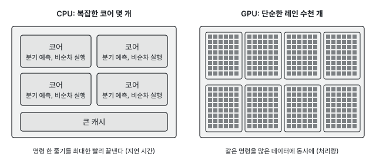
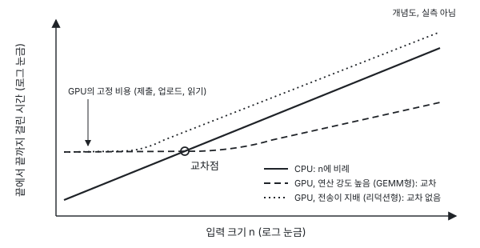

# GPU는 왜 빠르고, 언제 느린가

이 장을 읽고 나면 어떤 작업을 GPU에 맡길 만한지 코드를 쓰기 전에 대략 판단할 수 있습니다. 판단 기준은 세 가지입니다. 일이 원소마다 독립적인가, 옮기는 데이터에 비해 계산이 많은가, 입력이 고정 비용을 덮을 만큼 큰가. 근거는 이 저장소의 `compute-bench` 데모에서 잰 교차점입니다. 데모를 열어 두고 읽으면 좋습니다.

## CPU와 GPU는 다른 목표로 설계되었습니다

CPU 코어는 명령 한 줄기를 최대한 빨리 끝내도록 만들어졌습니다. 다음에 실행될 분기를 미리 예측하고, 앞 명령이 메모리를 기다리는 동안 뒤의 명령을 먼저 실행하고, 큰 캐시로 메모리 대기를 줄입니다. 이런 장치는 트랜지스터를 많이 쓰므로 한 칩에 코어를 몇 개에서 수십 개밖에 넣지 못합니다.

GPU는 반대로 합니다. 코어 하나하나에서 분기 예측이나 비순차 실행 같은 장치를 덜어 내고, 그 자리에 단순한 연산 장치를 많이 넣습니다. 한 GPU에 이런 연산 레인(lane)이 수천 개 있습니다. 레인들은 묶음으로 움직여서, 한 묶음은 같은 명령을 서로 다른 데이터에 동시에 실행합니다.



그래서 두 장치가 잘하는 일이 다릅니다.

- CPU는 앞 단계의 결과에 따라 다음 단계가 바뀌는 일을 잘합니다. 파서, 상태 머신, 트리 탐색, 대부분의 UI 로직이 그렇습니다.
- GPU는 같은 계산을 아주 많은 원소에 반복하는 일을 잘합니다. 픽셀마다 색을 계산하기, 행렬 곱, 입자 수만 개의 위치 갱신이 그렇습니다.

## 데이터 병렬: 원소마다 같은 일을 독립적으로

GPU에 맞는 일은 대개 아래처럼 생겼습니다.

```js
for (let i = 0; i < n; i++) {
  out[i] = f(input[i]);
}
```

반복 `i`가 다른 반복의 결과를 읽지 않습니다. 그래서 반복 1000개를 레인 1000개에 나눠 동시에 실행해도 결과가 같습니다. 이런 성질을 데이터 병렬(data parallelism)이라고 합니다. JS로 치면 콜백이 다른 원소를 보지 않는 `array.map(f)`입니다.

다음 코드는 다릅니다.

```js
let acc = 0;
for (let i = 0; i < n; i++) acc += input[i];
```

반복마다 바로 앞 반복의 `acc`가 필요합니다. 그대로는 나눌 수 없습니다. 이런 일도 GPU에서 할 수 있지만 계산 순서를 바꿔야 합니다. 원소를 짝지어 동시에 더하고, 그 결과를 다시 짝지어 더하는 트리 모양으로 바꿉니다. [3장 리덕션](03-compute-reduction.md)이 이 방법을 다룹니다.

> **핵심**
> GPU 코드를 쓰기 전에 "반복 하나가 다른 반복의 결과를 읽는가"를 먼저 확인합니다. 읽지 않으면 그대로 옮기면 됩니다. 읽는다면 알고리즘을 다시 짜야 합니다.

## 지연 시간과 처리량

두 용어를 구분해야 GPU의 성능 숫자를 읽을 수 있습니다.

- 지연 시간(latency)은 일 하나가 시작해서 끝날 때까지 걸리는 시간입니다.
- 처리량(throughput)은 단위 시간에 끝내는 일의 양입니다.

웹 개발에 비유하면 `fetch` 하나를 `await`하는 시간이 지연 시간이고, `Promise.all`로 요청 1000개를 한꺼번에 보냈을 때 초당 끝나는 요청 수가 처리량입니다. 요청을 동시에 보내도 요청 하나의 지연 시간은 줄지 않습니다. 그래도 전체 작업은 빨리 끝납니다.

GPU 레인 하나는 CPU 코어보다 느립니다. 클록이 낮고, 메모리에서 값을 읽으면 그 값이 올 때까지 오래 기다립니다. GPU는 이 대기를 없애지 않고 가립니다. 한 묶음의 레인이 메모리를 기다리는 동안 다른 묶음을 실행합니다. 이 방식이 통하려면 대기 중인 일이 항상 남아 있어야 하므로, GPU는 레인 수보다 훨씬 많은 작업이 있어야 제 속도를 냅니다.

이 사실에서 두 가지가 따라 나옵니다.

- 원소가 적으면 GPU의 대부분이 놉니다. 원소 100개짜리 배열은 GPU를 거의 쓰지 못합니다.
- GPU에 일 하나를 맡겼다가 결과를 받는 데 걸리는 시간, 즉 한 번의 지연 시간은 늘 일정 이상입니다. 이 부분은 다음 절에서 다룹니다.

## 고정 비용: GPU에 일을 맡기는 값

브라우저에서 GPU로 계산 하나를 하려면 다음 단계를 거칩니다. 자세한 코드는 [1장](01-webgpu-basics.md)에서 봅니다.

1. 입력을 CPU 메모리에서 GPU 버퍼로 복사합니다(업로드).
2. 실행할 명령을 기록해 GPU 큐에 제출합니다.
3. GPU가 계산합니다.
4. 결과를 GPU 버퍼에서 CPU가 읽을 수 있는 곳으로 복사하고 기다립니다(readback).

3번을 뺀 나머지는 입력이 아주 작아도 듭니다. 제출, 대기, 맵핑에는 원소 수와 상관없는 비용이 있습니다. 이 저장소의 행렬 곱(GEMM) 측정에서 n=32일 때 커널 자체는 0.02 ms였지만 업로드부터 읽기까지 전체는 0.4 ms였습니다. 기수 정렬은 패스를 40개 안팎 디스패치하므로 작은 입력에서도 GPU 시간이 1 ms 아래로 내려가지 않았습니다. 같은 크기에서 CPU는 0.01 ms였습니다. (헤드리스 Chromium, Apple M1, 1회 측정, 참고용)

> **용어**
> 이 사이트의 표에서 `e2e`(end to end)는 업로드부터 결과를 JS 배열로 받을 때까지의 벽시계 시간입니다. `kernel`은 GPU가 계산한 구간만 잰 시간입니다. CPU와 공정하게 비교하는 값은 `e2e`입니다. 재는 방법은 [9장](09-measuring.md)에서 다룹니다.

## 연산 강도: 옮긴 데이터 1바이트당 계산 몇 번

고정 비용을 넘은 뒤에도 GPU가 이기려면 조건이 하나 더 있습니다. 옮기는 데이터에 비해 계산이 많아야 합니다. 이 비율을 연산 강도(arithmetic intensity)라고 하고, 보통 "읽거나 옮긴 바이트당 연산 수"로 셉니다.

이 저장소의 워크로드로 계산하면 이렇습니다.

| 워크로드 | 옮기는 데이터 | 계산량 | 연산 강도 |
|---|---|---|---|
| 리덕션 (f32 n개의 합) | 4n 바이트 | 덧셈 n번 | 바이트당 0.25번, n과 무관 |
| 2D 히스토그램 (점 n개) | 8n 바이트 | 정수 덧셈 n번 | 바이트당 0.125번, n과 무관 |
| 행렬 곱 (n×n) | 행렬 셋, 12n² 바이트 | 2n³ FLOP | 바이트당 n/6 FLOP, n에 비례 |
| N-body (물체 N개, 한 스텝) | 첫 업로드 뒤 0 바이트 | 쌍마다 약 20 FLOP, N² 쌍 | 데이터가 GPU에 머묾 |

리덕션과 히스토그램은 n이 아무리 커져도 바이트당 계산이 일정합니다. 행렬 곱은 n이 2배가 되면 데이터는 4배, 계산은 8배가 되므로 n이 클수록 계산 쪽이 압도합니다. N-body는 상태가 GPU 버퍼에 계속 남아 있어서 매 스텝 옮기는 데이터가 없습니다.

연산 강도가 낮은 일은 GPU 안에서도 연산 장치보다 메모리 대역폭이 먼저 한계에 닿습니다. 그리고 브라우저에서는 그 전에 CPU에서 GPU로 가는 복사가 먼저 한계에 닿습니다.

## 전송이 이득을 지우는 경우

리덕션을 예로 듭니다. CPU는 배열을 한 번 훑으며 더하면 끝납니다. GPU는 먼저 같은 배열을 GPU 버퍼로 복사해야 합니다. 이 복사는 CPU가 배열을 한 번 읽는 것과 비슷한 양의 메모리 이동입니다. GPU 커널이 아무리 빨라도 e2e는 "CPU가 배열을 읽는 시간 + 복사 + 고정 비용"보다 짧아질 수 없습니다. 그래서 리덕션은 CPU를 따라잡지 못합니다.

2D 히스토그램은 이 효과를 숫자로 보여 줍니다. 점 2^24개(128 MiB)에서 GPU의 e2e 46 ms 중 커널은 6 ms 남짓이었습니다. 나머지는 거의 업로드입니다. (헤드리스 Chromium, Apple M1, 1회 측정, 참고용)

> **주의**
> Apple M1은 CPU와 GPU가 같은 메모리를 쓰는 통합 메모리 구조입니다. 그래도 WebGPU의 `writeBuffer`는 데이터를 복사하므로 전송 비용이 남습니다. 별도 그래픽 카드가 있는 PC에서는 데이터가 PCIe 버스를 건너가야 해서 전송 비중이 더 클 수 있습니다. 이 사이트의 숫자를 다른 기계에 그대로 옮기지 마세요.

전송을 줄이는 가장 확실한 방법은 데이터를 GPU에 두고 여러 단계를 GPU 안에서 이어 가는 것입니다. 시뮬레이션 결과를 읽어 오지 않고 바로 그리는 [7장 N-body](07-compute-to-render.md)가 이 경우입니다.

## 교차점: 이 저장소의 측정값

`compute-bench`는 같은 입력을 CPU 구현과 GPU 구현으로 풀고, 입력 크기 n을 키워 가며 e2e 중앙값을 비교합니다. 교차점(crossover)은 "그 n부터 측정한 모든 더 큰 n에서 GPU가 CPU보다 빠른 가장 작은 n"입니다. 정의는 `src/core/oneshot.ts`의 `crossoverN`에 있습니다.



그림은 개념도입니다. 작은 n에서 GPU 곡선은 고정 비용 때문에 평평합니다. 연산 강도가 높은 일은 n이 커지면서 GPU 곡선의 기울기가 CPU보다 완만해져 두 곡선이 만납니다. 전송이 지배하는 일은 GPU 곡선이 CPU와 거의 평행하게 올라가 만나지 않습니다.

실제 측정 결과는 다음과 같습니다. (헤드리스 Chromium, Apple M1, 1회 측정, 참고용)

| 워크로드 | 결과 | 이유 |
|---|---|---|
| 리덕션 | 측정 범위 2^10~2^24 원소에서 교차하지 않음 | 연산 강도가 낮아 업로드가 곧 비용 |
| 행렬 곱 | n=128에서 교차. n=2048에서 가장 빠른 GPU 구현의 e2e가 CPU보다 약 237배 빠름 | 연산 강도가 n에 비례 |
| 기수 정렬 | 2^19~2^20 부근에서 교차 (`TypedArray.sort` 기준) | 패스가 많아 고정 비용이 크고, 일은 n에 비례 |
| 2D 히스토그램 | 약 2^21에서 교차 | 커널은 빠르지만 업로드가 e2e의 대부분 |
| N-body (60 Hz 유지) | CPU는 약 2,750개, GPU는 약 26,000개 | 계산이 N², 데이터는 GPU에 머묾 |

N-body는 교차점 대신 "화면 주사율 60 Hz를 유지하는 최대 물체 수"로 비교했습니다. 물체 수가 약 10배이고, 계산하는 쌍의 수로는 약 90배입니다.

이 표에서 읽을 것은 숫자의 크기보다 모양입니다.

- 작은 입력에서는 모든 워크로드에서 CPU가 이깁니다.
- 연산 강도가 높을수록 일찍 교차하고 큰 입력에서 차이가 크게 벌어집니다.
- 연산 강도가 낮은 일은 커널이 빨라도 e2e에서 이기기 어렵습니다.

> **주의**
> 교차점은 비교 대상 CPU 구현에 따라 움직입니다. 기수 정렬은 `TypedArray.sort`와 비교하면 2^20 부근에서 GPU가 앞서지만, JS로 짠 기수 정렬(`cpu-radix`)과 비교하면 2^20에서 거의 동률입니다. "GPU가 몇 배 빠르다"는 말을 보면 무엇과 비교했는지 먼저 확인하세요.

> **해보기**
> `compute-bench` 데모에서 워크로드를 `리덕션`으로 두고 실행한 뒤, `GEMM`으로 바꿔 다시 실행해 보세요. 차트에서 실선(e2e)과 점선(kernel)의 간격을 비교합니다. 리덕션은 큰 n에서도 간격이 크게 남고, GEMM은 n이 커질수록 간격이 좁아집니다. 자기 기계의 교차점이 위 표와 얼마나 다른지도 확인해 보세요.

## 이 사이트를 쓰는 방법

이 사이트는 데모와 장(章)으로 되어 있습니다. `npm run dev`로 띄운 뒤 홈 화면에서 고릅니다.

데모는 모두 같은 원칙을 따릅니다. 각 데모는 공정한 비교 대상(CPU, SVG, Canvas2D, WebGL2)과 WebGPU 구현을 함께 두고, 둘의 결과가 같은지 먼저 확인한 다음 시간을 잽니다.

| 데모 | 무엇을 비교하나 | 관련 장 |
|---|---|---|
| `render-compare` | 튀는 원 N개를 SVG, Canvas2D, WebGL2, WebGPU로 그리기 | [2장](02-render-pipeline.md) |
| `compute-bench` | 리덕션, 행렬 곱, 기수 정렬, 2D 히스토그램의 CPU 대 GPU 교차점 | [3장](03-compute-reduction.md)~[6장](06-multi-pass-sort.md) |
| `nbody` | 물체 N개의 중력 시뮬레이션, JS 대 컴퓨트 셰이더 | [7장](07-compute-to-render.md) |
| `webcam-filter` | 카메라 영상 블러와 엣지 검출, Canvas2D 대 텍스처와 컴퓨트 | [8장](08-textures-video.md) |

장은 앞에서부터 읽도록 짜여 있습니다.

1. [1장 WebGPU 첫걸음](01-webgpu-basics.md): 계산 하나를 GPU에 맡기고 결과를 받는 전체 과정
2. [2장 렌더 파이프라인](02-render-pipeline.md): 화면에 그리기
3. [3장 리덕션](03-compute-reduction.md): 워크그룹, 디스패치 크기, 여러 패스
4. [4장 워크그룹 메모리와 타일링](04-workgroup-memory.md): 행렬 곱이 일찍 교차하는 이유
5. [5장 아토믹과 경합](05-atomics.md): 여러 레인이 같은 칸에 쓸 때
6. [6장 여러 패스로 정렬하기](06-multi-pass-sort.md): 기수 정렬
7. [7장 계산 결과를 바로 그리기](07-compute-to-render.md): N-body
8. [8장 텍스처와 비디오](08-textures-video.md): 실시간 필터
9. [9장 GPU 성능을 제대로 재는 법](09-measuring.md)

모르는 용어는 [용어집](glossary.md)에서 찾을 수 있습니다. 각 장은 데모 코드의 실제 파일과 이 저장소에서 잰 숫자를 인용합니다. 숫자는 모두 헤드리스 Chromium과 Apple M1 한 대에서 한 번 잰 참고값입니다. 결론을 내리기 전에 자기 기계의 일반 브라우저 창에서 다시 재 보세요.

## 정리

- GPU는 단순한 레인 수천 개로 처리량을 얻습니다. 일 하나의 지연 시간은 CPU보다 깁니다.
- GPU에 맞는 일은 원소마다 독립적인 데이터 병렬 작업입니다. 앞 결과에 의존하는 루프는 알고리즘을 바꿔야 합니다.
- GPU에 일을 맡길 때마다 업로드, 제출, 읽기의 고정 비용이 듭니다. 그래서 작은 입력에서는 CPU가 이깁니다.
- 옮긴 바이트당 계산이 많을수록(연산 강도가 높을수록) GPU가 일찍, 크게 이깁니다. 리덕션처럼 낮은 일은 교차하지 않을 수 있습니다.
- 데이터를 GPU에 둔 채로 여러 단계를 이어 가면 전송 비용을 피할 수 있습니다.

## 다음 장

[1장 WebGPU 첫걸음: adapter부터 readback까지](01-webgpu-basics.md)에서 숫자 배열을 GPU로 보내 두 배로 만들고 다시 읽어 오는 코드를 한 줄씩 따라갑니다.
