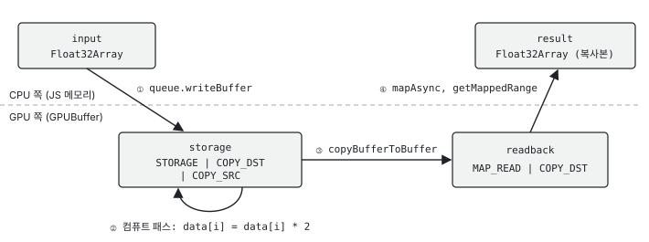
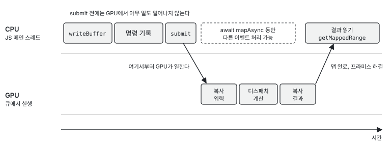

# WebGPU 첫걸음: adapter부터 readback까지

이 장을 읽고 나면 GPU에 계산 하나를 맡기고 결과를 JS 배열로 돌려받는 코드를 처음부터 끝까지 직접 쓸 수 있습니다. 예제는 숫자 1000개를 모두 두 배로 만드는 프로그램 하나입니다. 이 예제의 모든 단계는 `compute-bench` 데모의 리덕션 워크로드(`src/demos/compute-bench/workloads/reduction/index.ts`)에도 그대로 나옵니다. 장을 다 읽은 뒤 그 파일을 열어 보면 대부분의 줄을 읽을 수 있습니다.

## 전체 흐름

GPU 계산 한 번은 항상 같은 순서를 따릅니다.

1. GPU에 연결합니다. `adapter`를 얻고, 거기서 `device`를 만듭니다.
2. 입력 데이터를 JS 배열로 준비합니다.
3. GPU에서 돌 프로그램(셰이더)을 WGSL로 씁니다.
4. GPU 메모리에 버퍼를 만들고 입력을 올립니다.
5. 셰이더를 파이프라인으로 컴파일하고, 버퍼를 셰이더의 변수에 연결합니다(바인드 그룹).
6. 할 일을 명령으로 기록해 큐에 제출합니다.
7. 결과를 CPU가 읽을 수 있는 버퍼로 복사하고, 맵핑해서 읽습니다.

아래 완성 코드의 주석 번호가 이 순서와 같습니다. 이 장의 나머지는 번호 하나씩 설명합니다.

## 완성 코드

```ts
// 1. GPU 연결: adapter → device
if (!navigator.gpu) throw new Error('이 브라우저는 WebGPU를 지원하지 않습니다');
const adapter = await navigator.gpu.requestAdapter();
if (!adapter) throw new Error('사용할 수 있는 GPU 어댑터가 없습니다');
const device = await adapter.requestDevice();

device.addEventListener('uncapturederror', (e) => console.error('WebGPU 오류:', e.error.message));
device.lost.then((info) => console.warn(`device lost (${info.reason}): ${info.message}`));

// 2. 입력 데이터: 1000개의 f32
const input = new Float32Array(1000);
for (let i = 0; i < input.length; i++) input[i] = i;

// 3. 셰이더: 원소 하나당 invocation 하나가 값을 두 배로 만든다
const WGSL = /* wgsl */ `
@group(0) @binding(0) var<storage, read_write> data: array<f32>;

@compute @workgroup_size(64)
fn main(@builtin(global_invocation_id) id: vec3u) {
  let i = id.x;
  if (i >= arrayLength(&data)) {
    return;
  }
  data[i] = data[i] * 2.0;
}
`;

// 4. 버퍼: GPU가 계산할 storage 버퍼와 CPU가 읽을 readback 버퍼
const storage = device.createBuffer({
  size: input.byteLength,
  usage: GPUBufferUsage.STORAGE | GPUBufferUsage.COPY_DST | GPUBufferUsage.COPY_SRC,
});
const readback = device.createBuffer({
  size: input.byteLength,
  usage: GPUBufferUsage.MAP_READ | GPUBufferUsage.COPY_DST,
});
device.queue.writeBuffer(storage, 0, input);

// 5. 파이프라인과 바인드 그룹
const module = device.createShaderModule({ code: WGSL });
const pipeline = await device.createComputePipelineAsync({
  layout: 'auto',
  compute: { module, entryPoint: 'main' },
});
const bindGroup = device.createBindGroup({
  layout: pipeline.getBindGroupLayout(0),
  entries: [{ binding: 0, resource: { buffer: storage } }],
});

// 6. 명령 기록: 패스 → 디스패치 → 복사, 그리고 제출
const encoder = device.createCommandEncoder();
const pass = encoder.beginComputePass();
pass.setPipeline(pipeline);
pass.setBindGroup(0, bindGroup);
pass.dispatchWorkgroups(Math.ceil(input.length / 64));
pass.end();
encoder.copyBufferToBuffer(storage, 0, readback, 0, input.byteLength);
device.queue.submit([encoder.finish()]);

// 7. 결과 읽기
await readback.mapAsync(GPUMapMode.READ);
const result = new Float32Array(readback.getMappedRange().slice(0));
readback.unmap();

const wrong = result.findIndex((v, i) => v !== input[i]! * 2);
console.log('앞 8개:', Array.from(result.slice(0, 8)).join(', '));
console.log('마지막:', result[result.length - 1]);
console.log(wrong === -1 ? '1000개 모두 정확합니다' : `${wrong}번째 값이 틀렸습니다`);

storage.destroy();
readback.destroy();
```

`<script type="module">`로 불러오면 최상위 `await`를 쓸 수 있으므로 이 코드는 함수로 감싸지 않아도 됩니다. 이 코드를 헤드리스 Chromium(Apple M1)에서 실행한 콘솔 출력은 다음과 같습니다.

```text
앞 8개: 0, 2, 4, 6, 8, 10, 12, 14
마지막: 1998
1000개 모두 정확합니다
```

## 1. adapter와 device

```ts
if (!navigator.gpu) throw new Error('이 브라우저는 WebGPU를 지원하지 않습니다');
const adapter = await navigator.gpu.requestAdapter();
if (!adapter) throw new Error('사용할 수 있는 GPU 어댑터가 없습니다');
const device = await adapter.requestDevice();
```

WebGPU API는 `navigator.gpu`에서 시작합니다. 브라우저가 WebGPU를 지원하지 않거나 페이지가 보안 컨텍스트(HTTPS 또는 `localhost`)가 아니면 `navigator.gpu`는 `undefined`입니다.

어댑터(adapter, `GPUAdapter`)는 실제 GPU 하나와 그 드라이버를 나타냅니다. 어댑터로는 계산을 하지 않습니다. 어댑터에서는 그 GPU가 지원하는 기능(`adapter.features`)과 한계값(`adapter.limits`)을 알아봅니다. 쓸 수 있는 GPU가 없으면 `requestAdapter()`는 예외 대신 `null`을 돌려주므로 반드시 확인해야 합니다.

디바이스(device, `GPUDevice`)는 내 페이지와 GPU 사이의 논리적인 연결입니다. 버퍼, 셰이더, 파이프라인은 모두 디바이스가 만들고, 만든 디바이스 밖에서는 쓸 수 없습니다. 디바이스를 만들 때 필요한 기능과 한계값을 요청합니다. 요청하지 않은 기능은 어댑터가 지원해도 쓸 수 없습니다. `compute-bench`는 이렇게 요청합니다.

```ts
// src/demos/compute-bench/device.ts
export async function requestComputeDevice(caps: Capabilities): Promise<GPUDevice | null> {
  if (caps.webgpu.kind !== 'available') return null;
  const adapter = await navigator.gpu.requestAdapter();
  if (!adapter) return null;
  const device = await adapter.requestDevice({
    requiredFeatures: adapter.features.has('timestamp-query') ? ['timestamp-query'] : [],
    requiredLimits: {
      maxStorageBufferBindingSize: adapter.limits.maxStorageBufferBindingSize,
      maxBufferSize: adapter.limits.maxBufferSize,
    },
  });
  device.addEventListener('uncapturederror', (e) => console.error('WebGPU 오류:', (e as GPUUncapturedErrorEvent).error.message));
  return device;
}
```

GPU 시간을 재는 `timestamp-query` 기능은 어댑터가 지원할 때만 켭니다. 버퍼 크기 한계는 기본값이 작아서 큰 입력을 다루려고 어댑터의 최댓값까지 올립니다. 아무것도 요청하지 않으면 모든 기기에서 보장되는 기본 한계값이 적용됩니다.

큐(queue, `GPUQueue`)는 `device.queue`로 얻습니다. GPU에 일을 보내는 통로입니다. 데이터 업로드(`writeBuffer`)와 명령 제출(`submit`)이 모두 큐를 거칩니다.

> **핵심**
> 어댑터는 "어떤 GPU인가", 디바이스는 "그 GPU와 맺은 연결", 큐는 "그 연결로 일을 보내는 줄"입니다. 보통 페이지 하나에 디바이스 하나를 만들어 계속 씁니다.

## 2. 입력 데이터

```ts
const input = new Float32Array(1000);
for (let i = 0; i < input.length; i++) input[i] = i;
```

GPU에는 JS 배열(`Array`)을 보낼 수 없습니다. 원소마다 타입과 크기가 정해진 바이트 덩어리가 필요하므로 `Float32Array`, `Uint32Array` 같은 타입 배열(typed array)을 씁니다. `Float32Array`는 원소 하나가 4바이트 `f32`입니다. 그래서 이 배열은 `input.byteLength`가 4000입니다.

## 3. WGSL 셰이더

```wgsl
@group(0) @binding(0) var<storage, read_write> data: array<f32>;

@compute @workgroup_size(64)
fn main(@builtin(global_invocation_id) id: vec3u) {
  let i = id.x;
  if (i >= arrayLength(&data)) {
    return;
  }
  data[i] = data[i] * 2.0;
}
```

WGSL(WebGPU Shading Language)은 GPU에서 실행되는 함수를 쓰는 언어입니다. 이 셰이더는 원소 하나를 두 배로 만드는 함수 하나입니다. GPU는 이 함수를 원소 수만큼 동시에 실행합니다. 함수가 한 번 실행되는 단위를 호출(invocation)이라고 합니다. 함수 안에는 루프가 없습니다. JS의 `for` 루프 한 바퀴가 호출 하나가 됩니다.

### 타입

WGSL은 정적 타입 언어이고 숫자 타입을 엄격하게 구분합니다.

| 타입 | 뜻 |
|---|---|
| `f32` | 32비트 부동소수점. JS의 `Float32Array` 원소 |
| `u32`, `i32` | 32비트 부호 없는 정수, 부호 있는 정수 |
| `vec3u` | `u32` 세 개짜리 벡터. `vec3<u32>`의 줄임말이고 `.x`, `.y`, `.z`로 읽음 |
| `array<f32>` | 길이를 실행 시점에 정하는 `f32` 배열. 버퍼 크기로 길이가 정해짐 |
| `array<f32, 256>` | 길이 256으로 고정된 배열 |

`let`은 다시 대입할 수 없는 값이고 `var`는 바꿀 수 있는 변수입니다. JS의 `const`와 `let`에 해당합니다. WGSL에도 `const`가 있지만 컴파일 시점에 정해지는 상수에만 씁니다.

타입이 다른 값을 섞으면 컴파일 오류입니다. `let x: f32 = 1u;`는 `u32` 값을 `f32`에 넣으려 해서 실패합니다. 접미사 없는 리터럴(`2`, `2.0`)은 문맥에 맞는 타입으로 바뀌므로 `data[i] * 2.0`은 그대로 `f32` 곱셈이 됩니다. 정수 접미사는 `u`(부호 없음)와 `i`(부호 있음)입니다.

### 리소스 선언: `@group`, `@binding`, `var<storage>`

```wgsl
@group(0) @binding(0) var<storage, read_write> data: array<f32>;
```

셰이더 밖에서 들어오는 데이터는 함수 인자가 아니라 전역 변수로 선언합니다. `@group(0) @binding(0)`은 이 변수의 주소입니다. JS 쪽에서 "0번 그룹의 0번 칸에 이 버퍼를 연결한다"고 지정하면 셰이더의 `data`가 그 버퍼를 가리킵니다. 5절의 바인드 그룹이 이 연결을 맡습니다.

`var<...>` 안의 첫 단어는 주소 공간(address space)입니다. 변수가 어느 메모리에 있는지를 뜻합니다.

- `storage`: 크고 읽고 쓸 수 있는 버퍼. 두 번째 단어로 `read` 또는 `read_write`를 고릅니다.
- `uniform`: 작고 읽기만 하는 값. 모든 호출이 같은 값을 읽는 설정값(배열 길이, 시간 등)에 씁니다.
- `workgroup`: 한 워크그룹 안의 호출들이 함께 쓰는 빠른 메모리. [4장](04-workgroup-memory.md)에서 다룹니다.

리덕션 셰이더의 선언부에는 세 가지가 모두 나옵니다.

```wgsl
// src/demos/compute-bench/workloads/reduction/index.ts (WGSL 부분)
struct Params { count: u32 }
@group(0) @binding(0) var<storage, read> src: array<f32>;
@group(0) @binding(1) var<storage, read_write> dst: array<f32>;
@group(0) @binding(2) var<uniform> params: Params;

var<workgroup> scratch: array<f32, ${GROUP}>;
```

`${GROUP}`은 JS 템플릿 문자열의 치환입니다. 셰이더 코드는 결국 문자열이므로 JS 상수를 끼워 넣어 만듭니다.

### 진입점: `@compute`와 `@workgroup_size`

```wgsl
@compute @workgroup_size(64)
fn main(@builtin(global_invocation_id) id: vec3u) {
```

`@compute`는 이 함수가 컴퓨트 셰이더의 진입점(entry point)이라는 표시입니다. 이름은 자유이고 JS에서 `entryPoint: 'main'`으로 같은 이름을 지정합니다.

`@workgroup_size(64)`는 호출 64개를 한 묶음으로 실행한다는 뜻입니다. 이 묶음이 워크그룹(workgroup)입니다. GPU는 일을 워크그룹 단위로 나눠 실행합니다. JS 쪽에서는 호출 수가 아니라 워크그룹 수를 지정합니다(6절). 워크그룹 크기를 고르는 기준과 워크그룹 안에서 데이터를 나누는 방법은 [3장](03-compute-reduction.md)과 [4장](04-workgroup-memory.md)에서 다룹니다. 처음에는 64를 기본값으로 써도 됩니다.

### 내장 값: 나는 몇 번째 호출인가

모든 호출은 같은 코드를 실행합니다. 각자 다른 원소를 맡으려면 자기 번호를 알아야 합니다. `@builtin(...)`이 붙은 인자로 GPU가 그 번호를 넘겨줍니다.

| 내장 값 | 타입 | 뜻 |
|---|---|---|
| `global_invocation_id` | `vec3u` | 전체 디스패치에서 이 호출의 번호 |
| `local_invocation_id` | `vec3u` | 워크그룹 안에서 이 호출의 번호 (0~63) |
| `local_invocation_index` | `u32` | `local_invocation_id`를 한 줄로 편 번호 |
| `workgroup_id` | `vec3u` | 이 호출이 속한 워크그룹의 번호 |
| `num_workgroups` | `vec3u` | 디스패치한 워크그룹 수 |

1차원 일에서는 `global_invocation_id.x = workgroup_id.x × 64 + local_invocation_id.x`입니다. 이 예제는 이 값을 배열 인덱스로 씁니다. 리덕션 셰이더는 워크그룹 단위로 일을 나누므로 `workgroup_id`와 `local_invocation_index`를 받습니다.

### 범위 검사

```wgsl
  if (i >= arrayLength(&data)) {
    return;
  }
```

워크그룹은 64개 단위로만 실행됩니다. 원소 1000개를 덮으려면 워크그룹 16개, 즉 호출 1024개가 필요합니다. 마지막 24개 호출은 배열 밖의 인덱스 1000~1023을 받습니다. `arrayLength(&data)`는 버퍼 크기에서 계산한 배열 길이(1000)를 돌려주고, 그보다 큰 인덱스를 받은 호출은 아무것도 하지 않고 끝납니다.

WebGPU는 범위 밖 접근이 다른 메모리를 망가뜨리지 않도록 막습니다. 다만 결과는 보장하지 않습니다. 범위 밖 쓰기는 버려질 수도 있고, 같은 버퍼 안의 다른 위치에 쓰일 수도 있습니다. 그래서 범위 검사는 직접 해야 합니다.

> **해보기**
> 범위 검사 세 줄을 지우고 실행해 보세요. 이 장을 쓴 기계(Apple M1, Chromium)에서는 그래도 1000개가 모두 맞게 나왔습니다. 범위 밖 쓰기가 버려졌기 때문입니다. 이 결과는 보장이 아닙니다. 다른 GPU에서는 배열 끝의 값이 두 번 이상 곱해질 수 있습니다.

## 4. 버퍼와 usage 플래그

```ts
const storage = device.createBuffer({
  size: input.byteLength,
  usage: GPUBufferUsage.STORAGE | GPUBufferUsage.COPY_DST | GPUBufferUsage.COPY_SRC,
});
const readback = device.createBuffer({
  size: input.byteLength,
  usage: GPUBufferUsage.MAP_READ | GPUBufferUsage.COPY_DST,
});
device.queue.writeBuffer(storage, 0, input);
```

버퍼(`GPUBuffer`)는 GPU가 관리하는 메모리의 바이트 덩어리입니다. 버퍼 자체에는 타입이 없습니다. 같은 4000바이트를 셰이더는 `array<f32>`로 읽고, JS는 `Float32Array`로 읽습니다. 두 쪽이 같은 해석을 쓰도록 맞추는 일은 개발자 몫입니다.

`size`는 바이트 단위입니다. 원소 수를 넣는 실수가 흔하므로 `byteLength`나 `n * 4`로 씁니다.

`usage`는 이 버퍼를 무엇에 쓸지 미리 밝히는 비트 플래그입니다. 여기에 없는 용도로 버퍼를 쓰면 오류가 납니다. GPU 드라이버는 이 정보를 보고 버퍼를 둘 메모리 종류를 정합니다.

| 플래그 | 허용하는 일 |
|---|---|
| `STORAGE` | 셰이더의 `var<storage>`에 연결 |
| `UNIFORM` | 셰이더의 `var<uniform>`에 연결 |
| `COPY_DST` | 이 버퍼에 쓰기. `writeBuffer`와 복사 명령의 대상 |
| `COPY_SRC` | 이 버퍼에서 다른 버퍼로 복사 |
| `MAP_READ` | CPU가 맵핑해서 읽기 |
| `MAP_WRITE` | CPU가 맵핑해서 쓰기 |
| `VERTEX`, `INDEX` | 렌더링의 정점, 인덱스 데이터. [2장](02-render-pipeline.md) |

예제가 버퍼를 두 개 만드는 이유는 `MAP_READ`의 제약 때문입니다. `MAP_READ`는 `COPY_DST`하고만 함께 쓸 수 있습니다. 셰이더가 쓰는 `STORAGE` 버퍼는 CPU가 직접 읽을 수 없습니다. 그래서 계산은 `storage`에서 하고, 결과를 `readback`으로 복사한 뒤 그쪽을 읽습니다. 이렇게 읽기 전용으로 두는 버퍼를 스테이징 버퍼(staging buffer)라고도 부릅니다.

`storage`에 붙은 플래그 셋은 각각 이유가 있습니다. `STORAGE`는 셰이더가 쓰기 위해, `COPY_DST`는 `writeBuffer`로 입력을 받기 위해, `COPY_SRC`는 결과를 `readback`으로 복사하기 위해 필요합니다.

`queue.writeBuffer(buffer, offset, data)`는 JS 배열의 내용을 버퍼에 올립니다. 호출하는 순간 데이터를 복사해 두므로 호출 직후 `input`을 고쳐도 업로드되는 값은 바뀌지 않습니다. 실제 GPU 쪽 복사는 큐에서 나중에 일어나고, 그 뒤에 제출한 명령보다 먼저 끝납니다. 쓰는 크기는 4바이트의 배수여야 합니다.



## 5. 파이프라인과 바인드 그룹

```ts
const module = device.createShaderModule({ code: WGSL });
const pipeline = await device.createComputePipelineAsync({
  layout: 'auto',
  compute: { module, entryPoint: 'main' },
});
const bindGroup = device.createBindGroup({
  layout: pipeline.getBindGroupLayout(0),
  entries: [{ binding: 0, resource: { buffer: storage } }],
});
```

`createShaderModule`은 WGSL 문자열을 받아 셰이더 모듈을 만듭니다. 문법 오류는 이 단계에서 드러납니다. 오류를 확인하는 방법은 9절에서 다룹니다.

컴퓨트 파이프라인(compute pipeline)은 "어떤 셰이더의 어떤 진입점을, 어떤 모양의 리소스와 함께 실행하는가"를 묶어 GPU용 기계어로 컴파일한 결과입니다. 컴파일은 시간이 걸리므로 `createComputePipelineAsync`로 기다리는 동안 메인 스레드를 막지 않습니다. 동기 버전 `createComputePipeline`도 있지만 이 저장소는 모든 곳에서 비동기 버전을 씁니다.

`layout`은 파이프라인이 기대하는 리소스의 모양입니다. 몇 번 그룹의 몇 번 칸에 어떤 종류의 리소스가 오는지를 적은 표입니다. `'auto'`를 주면 WebGPU가 셰이더 코드를 읽어 이 표를 만들어 줍니다. 이 예제처럼 파이프라인 하나를 쓰는 동안은 `'auto'`로 충분합니다.

`'auto'`에는 제약이 두 가지 있습니다.

- 진입점이 실제로 쓰지 않는 변수는 표에서 빠집니다. 셰이더에 선언만 하고 쓰지 않은 바인딩에 버퍼를 연결하면 바인드 그룹을 만들 때 오류가 납니다.
- `'auto'`로 만든 레이아웃은 그 파이프라인 전용입니다. 같은 바인드 그룹을 다른 파이프라인에서 쓰려면 `createBindGroupLayout`과 `createPipelineLayout`으로 레이아웃을 직접 만들어 양쪽에 줘야 합니다.

바인드 그룹(bind group)은 레이아웃의 칸마다 실제 리소스를 채운 것입니다. JS로 치면 셰이더 호출에 넘기는 인자 객체입니다. `pipeline.getBindGroupLayout(0)`으로 0번 그룹의 레이아웃을 받고, `entries`의 `binding` 번호를 WGSL의 `@binding` 번호와 맞춥니다. 리덕션 워크로드는 칸이 셋입니다.

```ts
// src/demos/compute-bench/workloads/reduction/index.ts
const bindGroup = device.createBindGroup({
  layout: pipeline.getBindGroupLayout(0),
  entries: [
    { binding: 0, resource: { buffer: src } },
    { binding: 1, resource: { buffer: dst } },
    { binding: 2, resource: { buffer: params } },
  ],
});
```

파이프라인과 바인드 그룹은 한 번 만들어 두고 여러 번 씁니다. `compute-bench`의 GPU 구현은 이 둘과 모든 버퍼를 `prepare` 단계에서 만들고, 시간을 재는 구간에서는 새로 만들지 않습니다.

## 6. 명령 기록과 제출

```ts
const encoder = device.createCommandEncoder();
const pass = encoder.beginComputePass();
pass.setPipeline(pipeline);
pass.setBindGroup(0, bindGroup);
pass.dispatchWorkgroups(Math.ceil(input.length / 64));
pass.end();
encoder.copyBufferToBuffer(storage, 0, readback, 0, input.byteLength);
device.queue.submit([encoder.finish()]);
```

WebGPU에서는 GPU에 일을 하나씩 시키지 않습니다. 할 일을 명령 목록으로 먼저 기록하고, 목록 전체를 한 번에 제출합니다. 기록하는 동안 GPU에서는 아무 일도 일어나지 않습니다.

- `createCommandEncoder()`는 명령을 기록할 인코더를 만듭니다.
- `beginComputePass()`는 컴퓨트 패스(compute pass)를 엽니다. 패스는 같은 종류의 GPU 작업을 묶는 구간입니다.
- `setPipeline`과 `setBindGroup`은 다음 디스패치에서 쓸 셰이더와 리소스를 고릅니다. `setBindGroup`의 첫 인자 0이 WGSL의 `@group(0)`입니다.
- `dispatchWorkgroups(16)`은 워크그룹 16개를 실행하라는 명령입니다. 호출 수가 아니라 워크그룹 수를 넘깁니다. 원소 수를 워크그룹 크기로 나눠 올림하는 `Math.ceil(n / 64)`는 컴퓨트 코드에서 계속 나오는 식입니다. 2차원, 3차원 일은 `dispatchWorkgroups(x, y, z)`로 넘깁니다. 기본 한계는 차원마다 65535개입니다.
- `pass.end()`로 패스를 닫습니다. 버퍼 복사(`copyBufferToBuffer`)는 패스 밖, 인코더에 직접 기록합니다.
- `encoder.finish()`는 기록을 마치고 명령 버퍼(`GPUCommandBuffer`)를 돌려줍니다. `queue.submit([...])`이 그것을 GPU로 보냅니다.

한 인코더에 패스를 여러 개 기록할 수 있습니다. 리덕션은 입력을 1024분의 1씩 줄이는 패스를 값이 하나 남을 때까지 반복해서 기록하고, 마지막에 결과 4바이트를 복사합니다.

```ts
// src/demos/compute-bench/workloads/reduction/index.ts
passes.forEach((p, i) => {
  // ... timestampWrites 계산 생략
  const pass = encoder.beginComputePass({ timestampWrites });
  pass.setPipeline(pipeline);
  pass.setBindGroup(0, p.bindGroup);
  pass.dispatchWorkgroups(p.groups);
  pass.end();
});
encoder.copyBufferToBuffer(finalBuf, 0, readBuf, 0, 4);
```

앞 패스가 쓴 버퍼를 다음 패스가 읽어도 따로 기다리는 코드가 없습니다. 같은 큐에 제출한 명령은 순서대로 실행되고, 패스 경계에서 앞 패스의 쓰기가 다음 패스에 보이도록 WebGPU가 보장합니다. 여러 패스를 쓰는 패턴은 [6장](06-multi-pass-sort.md)에서 자세히 다룹니다.

> **용어**
> `submit`은 `fetch`와 달리 프라미스를 돌려주지 않습니다. 명령을 큐에 넣고 바로 반환합니다. 제출한 일이 끝났는지 알고 싶으면 `device.queue.onSubmittedWorkDone()`이 돌려주는 프라미스를 기다리거나, 결과 버퍼에 `mapAsync`를 겁니다.

## 7. 결과 읽기: mapAsync

```ts
await readback.mapAsync(GPUMapMode.READ);
const result = new Float32Array(readback.getMappedRange().slice(0));
readback.unmap();
```

GPU 버퍼의 내용을 JS에서 보려면 맵핑(mapping)이 필요합니다. 맵핑은 버퍼의 소유권을 잠시 GPU에서 CPU로 넘기는 일입니다.

- `mapAsync(GPUMapMode.READ)`는 이 버퍼를 쓰는 GPU 작업이 모두 끝난 뒤 버퍼를 CPU가 읽을 수 있게 만들고, 그때 프라미스를 해결합니다. 앞에서 제출한 복사가 끝나야 해결되므로 따로 완료를 기다릴 필요가 없습니다.
- `getMappedRange()`는 맵핑된 메모리를 `ArrayBuffer`로 돌려줍니다.
- `unmap()`은 소유권을 GPU에 돌려줍니다. 이때 `getMappedRange()`가 준 `ArrayBuffer`는 분리(detach)되어 길이가 0이 됩니다.

그래서 `.slice(0)`으로 내용을 먼저 복사합니다. `slice` 없이 `new Float32Array(readback.getMappedRange())`로 만든 배열은 `unmap()` 뒤에 비어 버립니다. 맵핑된 동안에는 그 버퍼를 GPU 명령에 쓸 수 없으므로, 같은 버퍼로 다시 계산하려면 꼭 `unmap()`해야 합니다.

리덕션 워크로드의 `readback`도 같은 세 줄입니다.

```ts
// src/demos/compute-bench/workloads/reduction/index.ts
async readback() {
  await readBuf.mapAsync(GPUMapMode.READ);
  const value = new Float32Array(readBuf.getMappedRange().slice(0))[0]!;
  readBuf.unmap();
  return value;
},
```

마지막으로 `destroy()`는 버퍼의 GPU 메모리를 바로 돌려줍니다. 가비지 컬렉터도 언젠가 회수하지만 시점을 알 수 없으므로, 큰 버퍼는 다 쓰면 직접 해제합니다.

## 8. 왜 모든 것이 비동기인가

예제 코드에는 `await`가 네 번 나옵니다. `requestAdapter`, `requestDevice`, `createComputePipelineAsync`, `mapAsync`입니다. 반면 `createBuffer`, `writeBuffer`, `submit`은 동기 함수처럼 바로 반환합니다. 그런데 이 동기 함수들도 일을 끝내고 반환하는 것이 아닙니다. 일을 예약하고 반환합니다.

GPU는 CPU와 따로 움직이는 별도 프로세서입니다. Chrome에서는 페이지의 WebGPU 호출이 GPU 프로세스라는 별도 프로세스로 전달되고, 거기서 드라이버를 거쳐 GPU에 도착합니다. WebGPU 명세는 이 흐름을 세 개의 시간축(timeline)으로 설명합니다. JS가 실행되는 콘텐츠 시간축, 브라우저의 GPU 프로세스가 객체를 만들고 검증하는 디바이스 시간축, GPU가 실제로 명령을 실행하는 큐 시간축입니다.



JS가 `submit`을 마치고 다음 줄로 갈 때 GPU는 아직 시작도 하지 않았을 수 있습니다. 결과가 필요한 순간에만 `mapAsync`나 `onSubmittedWorkDone`으로 기다립니다. 기다리는 동안 메인 스레드는 다른 이벤트를 처리할 수 있습니다.

이 구조 때문에 시간을 잴 때 조심해야 합니다. `submit` 앞뒤로 `performance.now()`를 찍으면 GPU가 계산한 시간이 아니라 명령을 예약한 시간이 나옵니다. `compute-bench`는 업로드부터 결과를 읽을 때까지를 한 구간으로 잽니다.

```ts
// src/core/oneshot.ts
const t0 = performance.now();
run.upload();
const encoder = device.createCommandEncoder();
run.encode(encoder, timer ?? undefined);
timer?.resolve(encoder);
device.queue.submit([encoder.finish()]);
const timed = timer?.afterSubmit();
await device.queue.onSubmittedWorkDone();
const t1 = performance.now();
const output = await run.readback();
const t2 = performance.now();
```

`t1 - t0`은 업로드와 계산, `t2 - t1`은 읽기, `t2 - t0`이 [0장](00-why-gpu.md)에서 말한 e2e입니다. 정확한 측정 방법은 [9장](09-measuring.md)에서 다룹니다.

## 9. 오류 처리

WebGPU의 대부분의 호출은 잘못된 인자를 받아도 예외를 던지지 않습니다. 대신 "무효(invalid)" 상태의 객체를 돌려주고 오류는 나중에 따로 알립니다. 검증이 GPU 프로세스에서 비동기로 일어나기 때문입니다. 무효 객체를 다른 호출에 넘기면 그 호출도 무효가 됩니다. 그래서 오류를 놓치면 결과가 조용히 틀립니다.

> **해보기**
> 완성 코드에서 `storage`의 `GPUBufferUsage.COPY_SRC`를 지우고 실행해 보세요. 예외 없이 끝까지 실행되고 결과는 모두 0입니다. 콘솔에는 `copyBufferToBuffer`에서 원본 버퍼에 `CopySrc`가 없다는 오류와, 그 때문에 명령 버퍼 전체가 무효라서 `submit`이 거부되었다는 오류가 찍힙니다. 디스패치도 함께 버려졌으므로 GPU는 아무것도 계산하지 않았습니다.

오류를 받는 방법은 세 가지입니다. 아래 코드는 완성 코드의 1번 단계로 `device`를 만든 뒤 실행한 것입니다.

```ts
// (가) 잡지 않은 오류: MAP_READ는 COPY_DST하고만 함께 쓸 수 있다
device.createBuffer({ size: 16, usage: GPUBufferUsage.MAP_READ | GPUBufferUsage.STORAGE });

// (나) 오류 스코프로 직접 잡기
device.pushErrorScope('validation');
device.createBuffer({ size: 16, usage: GPUBufferUsage.MAP_READ | GPUBufferUsage.STORAGE });
const error = await device.popErrorScope();
console.log('스코프가 잡은 오류:', error ? error.constructor.name : '없음');

// (다) 셰이더 컴파일 메시지 확인
const broken = device.createShaderModule({ code: 'fn main() { let x: f32 = 1u; }' });
const info = await broken.getCompilationInfo();
for (const m of info.messages) console.log(`${m.type} ${m.lineNum}:${m.linePos} ${m.message}`);

// (라) device를 직접 파괴하면 lost가 'destroyed'로 끝난다
device.destroy();
```

실행 결과입니다. Chrome은 같은 메시지를 개발자 도구 콘솔에 경고로도 한 번 더 찍는데, 아래에서는 뺐습니다.

```text
[error] WebGPU 오류: Buffer usages (BufferUsage::(MapRead|Storage)) is invalid. If a buffer usage contains BufferUsage::MapRead the only other allowed usage is BufferUsage::CopyDst.
 - While calling [Device].CreateBuffer([BufferDescriptor]).
[log] 스코프가 잡은 오류: GPUValidationError
[error] WebGPU 오류: Error while parsing WGSL: :1:17 error: cannot initialize 'let' of type 'f32' with value of type 'u32'
fn main() { let x: f32 = 1u; }
                ^
 - While calling [Device].CreateShaderModule([ShaderModuleDescriptor]).
[log] error 1:17 cannot initialize 'let' of type 'f32' with value of type 'u32'
[warning] device lost (destroyed): Device was destroyed.
```

### `uncapturederror` 이벤트

(가)처럼 아무도 잡지 않은 오류는 디바이스의 `uncapturederror` 이벤트로 옵니다. 완성 코드는 디바이스를 만들자마자 이 리스너를 답니다. 이 저장소의 모든 데모도 같은 리스너를 둡니다(`src/demos/compute-bench/device.ts`). 개발 중에는 이 리스너 하나로 대부분의 실수를 찾을 수 있습니다.

### 오류 스코프

(나)처럼 특정 구간의 오류를 코드에서 직접 받으려면 `pushErrorScope`와 `popErrorScope`로 감쌉니다. 필터는 `'validation'`(잘못된 사용), `'out-of-memory'`(메모리 부족), `'internal'`(구현 내부 문제) 중 하나입니다. `popErrorScope()`는 그 구간의 첫 오류를 프라미스로 돌려주고, 오류가 없으면 `null`을 돌려줍니다. 스코프가 잡은 오류는 `uncapturederror`로 가지 않습니다. 큰 버퍼를 만들 때 `'out-of-memory'` 스코프로 감싸면 메모리 부족을 처리할 수 있습니다.

### 셰이더 컴파일 메시지

(다)의 `getCompilationInfo()`는 셰이더 모듈의 오류와 경고를 줄 번호와 함께 돌려줍니다. 셰이더 문법 오류는 `uncapturederror`로도 오지만, 이 함수를 쓰면 메시지를 화면에 보여 주는 등 직접 다룰 수 있습니다. `createComputePipelineAsync`는 파이프라인을 만들지 못하면 반환한 프라미스를 거부(reject)하므로 `try`/`catch`로 받습니다.

### 디바이스 손실

디바이스는 쓰는 도중에 사라질 수 있습니다. GPU 드라이버가 충돌하거나 업데이트되면, 또는 셰이더 하나가 GPU를 너무 오래 붙잡아 운영체제가 GPU를 재설정하면 디바이스가 손실(device lost)됩니다. 그러면 `device.lost` 프라미스가 해결되고, 그 디바이스로 만든 모든 객체를 더 쓸 수 없습니다. `reason`은 `'destroyed'`(코드가 `device.destroy()`를 불렀음) 또는 `'unknown'`(그 밖의 이유) 중 하나입니다.

손실된 디바이스는 되살릴 수 없습니다. 어댑터부터 다시 요청해 새 디바이스를 만들고 버퍼와 파이프라인을 다시 만들어야 합니다. `webcam-filter` 데모는 페이지가 공유하는 디바이스를 손실 시점에 비워서 다음 요청이 새 디바이스를 만들게 합니다.

```ts
// src/demos/webcam-filter/variants.ts
void device.lost.then(() => {
  sharedDevice = null;
});
```

## 정리

- `requestAdapter`로 GPU를 찾고 `requestDevice`로 연결을 만듭니다. 버퍼와 파이프라인은 디바이스가 만들고, 일은 `device.queue`로 보냅니다.
- 버퍼는 타입 없는 바이트 덩어리이고 `usage` 플래그로 용도를 미리 밝힙니다. CPU가 결과를 읽으려면 `MAP_READ | COPY_DST` 버퍼로 복사한 뒤 `mapAsync`합니다.
- WGSL 셰이더는 원소 하나를 처리하는 함수입니다. `global_invocation_id`로 자기 원소를 찾고, 워크그룹 크기에 맞춰 남는 호출은 범위 검사로 걸러 냅니다.
- 명령은 인코더에 기록하고 `submit`으로 한 번에 보냅니다. `submit`은 기다리지 않으며, 결과는 `mapAsync`나 `onSubmittedWorkDone`으로 기다립니다.
- 잘못된 호출은 예외 대신 무효 객체와 비동기 오류로 끝납니다. `uncapturederror` 리스너와 `device.lost` 처리를 항상 붙입니다.

## 다음 장

[2장 렌더 파이프라인으로 원 그리기](02-render-pipeline.md)에서는 같은 디바이스와 버퍼로 계산 대신 화면에 원을 그립니다. 컴퓨트를 먼저 깊게 보고 싶다면 [3장 리덕션](03-compute-reduction.md)으로 바로 가도 됩니다.
