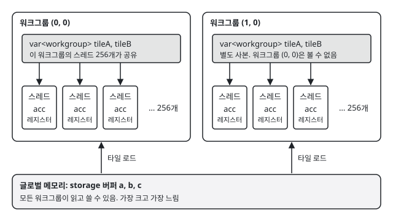
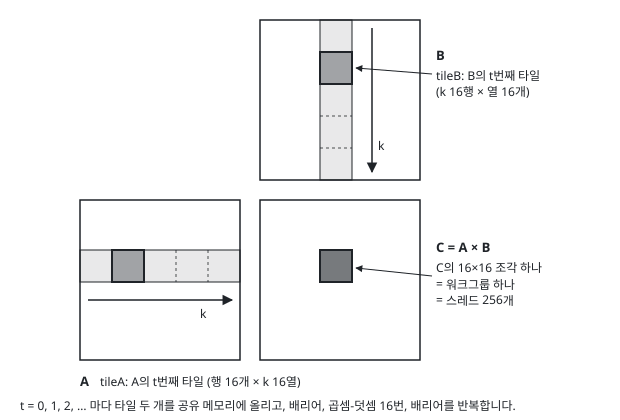
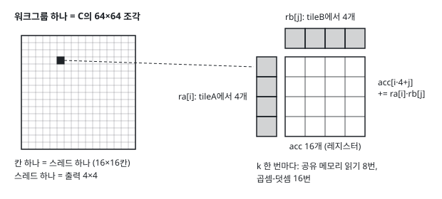

# 워크그룹 메모리와 타일링: 행렬 곱

이 장을 읽고 나면 GPU 메모리가 세 층으로 나뉘는 이유와, 같은 계산을 메모리 접근만 바꿔 몇 배 빠르게 만드는 방법을 설명할 수 있습니다. 예제는 행렬 곱(GEMM, `C = A × B`)이고, 커널 세 개를 차례로 고쳐 가며 봅니다. 데모는 컴퓨트 벤치에서 워크로드 목록의 "행렬 곱 GEMM"을 고르면 됩니다.

[03장](03-compute-reduction.md)에서 워크그룹, `global_invocation_id`, 디스패치 크기 계산을 배웠다고 가정합니다. 이 장에서는 스레드 하나를 "인보케이션(invocation)" 하나와 같은 뜻으로 씁니다.

관련 코드는 모두 `src/demos/compute-bench/workloads/gemm/`에 있습니다.

| 파일 | 내용 |
|---|---|
| `kernels.ts` | WGSL 커널 세 개 (`NAIVE_WGSL`, `TILED_WGSL`, `BLOCKED_WGSL`) |
| `gpu.ts` | 버퍼, 바인드 그룹, 디스패치 |
| `cpu.ts` | JS 삼중 루프 두 개 (`cpu-naive`, `cpu-ikj`) |
| `verify.ts` | 무작위 64개 원소를 f64로 다시 계산해 비교 |

## 행렬 곱이 GPU에 잘 맞는 이유

n×n 행렬 두 개를 곱하면 출력 원소 n²개가 생기고, 원소 하나마다 곱셈-덧셈(FMA)을 n번 합니다. 연산은 2n³ FLOP입니다. 옮기는 데이터는 `A`, `B` 업로드와 `C` 읽기를 합쳐 3n²개입니다.

옮긴 값 하나당 연산이 n에 비례해 늘어납니다. n=2048이면 값 하나당 약 1,365 FLOP입니다. 이 비율을 산술 강도(arithmetic intensity)라고 부릅니다. [03장의 리덕션](03-compute-reduction.md)은 값 하나를 올려 덧셈 한 번을 하니 산술 강도가 1에 가깝고, 업로드 시간이 곧 전체 시간이었습니다. 행렬 곱은 n이 커질수록 업로드, 제출, 읽기 같은 고정 비용이 연산 시간에 묻힙니다. 그래서 CPU와 GPU의 시간이 일찍 교차합니다. 교차점 개념은 [00장](00-why-gpu.md)에서 다뤘습니다.

> **용어**
> FLOP은 부동소수점 연산 하나입니다. FMA `acc += a * b`는 곱셈과 덧셈이라 2 FLOP으로 셉니다. `index.ts`의 `work`가 `2 * n ** 3`을 GFLOP 단위로 돌려주고, 표의 처리량 열은 이 값을 e2e 시간으로 나눈 것입니다.

## 출발점: 출력 원소 하나에 스레드 하나

가장 단순한 커널은 스레드 하나가 `C[y][x]` 하나를 맡습니다. `k`를 0부터 n-1까지 돌며 `A`의 한 행과 `B`의 한 열을 곱해 더합니다.

`src/demos/compute-bench/workloads/gemm/kernels.ts` 12~21행:

```wgsl
@compute @workgroup_size(${TILE}, ${TILE})
fn main(@builtin(global_invocation_id) gid: vec3u) {
  let n = params.n;
  if (gid.x >= n || gid.y >= n) { return; }
  var acc = 0.0;
  for (var k = 0u; k < n; k++) {
    acc += a[gid.y * n + k] * b[k * n + gid.x];
  }
  c[gid.y * n + gid.x] = acc;
}
```

WGSL 코드는 TS 템플릿 문자열 안에 있습니다. `${TILE}`은 셰이더를 컴파일하기 전에 JS가 `16`으로 바꿉니다.

이 커널은 맞게 동작하지만 FMA 한 번마다 `a`와 `b`를 하나씩, 즉 글로벌 메모리에서 값 두 개를 읽습니다. 같은 행의 스레드 16개는 모두 `a`의 같은 행을 읽고, 같은 열의 스레드 16개는 `b`의 같은 열을 읽습니다. 같은 값을 여러 스레드가 따로 가져오는 셈입니다. 하드웨어 캐시가 일부를 덜어 주지만, 커널 코드가 그 재사용을 정하지는 못합니다.

## 메모리는 세 층입니다



| 층 | WGSL에서 | 누가 보나 | 특징 |
|---|---|---|---|
| 글로벌 메모리 | `var<storage>` 버퍼 | 모든 워크그룹, 그리고 CPU(복사를 거쳐) | 크고 가장 느림 |
| 워크그룹 메모리 | `var<workgroup>` | 같은 워크그룹의 스레드만 | 작음. 기본 한도 16 KiB |
| 레지스터 | 함수 안의 `var`, `let` | 스레드 자신만 | 가장 빠름. 개수가 적음 |

웹 개발에 빗대면 글로벌 메모리는 서버 DB, 워크그룹 메모리는 한 페이지 안에서 컴포넌트끼리 나눠 쓰는 메모리 캐시, 레지스터는 함수의 지역 변수에 가깝습니다. 비유는 여기까지만 맞습니다. 워크그룹 메모리는 워크그룹이 시작할 때 생기고 끝나면 사라지며, 다른 워크그룹은 그 내용을 볼 수 없습니다.

`var<workgroup>` 크기의 기본 한도(`maxComputeWorkgroupStorageSize`)는 16,384바이트입니다. 이 저장소의 `src/demos/compute-bench/device.ts`는 버퍼 크기 한도만 올리고 이 한도는 기본값을 그대로 씁니다.

## 타일링: 한 번 읽고 여러 번 쓰기

타일링(tiling)은 워크그룹 하나가 `C`의 16×16 조각 하나를 맡게 하는 방법입니다. 이 조각을 계산하려면 `A`의 행 16개와 `B`의 열 16개가 필요합니다. 이것을 k 방향으로 16씩 잘라 타일 `t = 0, 1, 2, …` 단위로 처리합니다.



타일 하나마다 워크그룹은 네 단계를 거칩니다.

1. 스레드 256개가 `A` 타일과 `B` 타일에서 값을 하나씩 읽어 `tileA`, `tileB`에 씁니다. 글로벌 메모리 읽기는 스레드당 2번입니다.
2. `workgroupBarrier()`에서 모든 스레드가 쓰기를 마칠 때까지 기다립니다.
3. 각 스레드가 `tileA`의 한 행과 `tileB`의 한 열로 FMA를 16번 합니다. 이때는 워크그룹 메모리만 읽습니다.
4. 다음 타일을 덮어쓰기 전에 `workgroupBarrier()`를 한 번 더 합니다.

`src/demos/compute-bench/workloads/gemm/kernels.ts` 44~54행:

```wgsl
  for (var t = 0u; t < tiles; t++) {
    let ak = t * ${TILE}u + lid.x;
    let bk = t * ${TILE}u + lid.y;
    tileA[lid.y * ${TILE}u + lid.x] = select(0.0, a[row * n + ak], row < n && ak < n);
    tileB[lid.y * ${TILE}u + lid.x] = select(0.0, b[bk * n + col], bk < n && col < n);
    workgroupBarrier();
    for (var k = 0u; k < ${TILE}u; k++) {
      acc += tileA[lid.y * ${TILE}u + k] * tileB[k * ${TILE}u + lid.x];
    }
    workgroupBarrier();
  }
```

`tileA`와 `tileB`는 31~32행에서 `var<workgroup> tileA: array<f32, ${TILE * TILE}>;`로 선언합니다. 16×16 f32 두 개라 2 KiB입니다. 글로벌 메모리에서 한 번 읽은 값을 워크그룹의 스레드 16개가 다시 씁니다.

### 배리어가 두 번 필요한 이유

`workgroupBarrier()`는 같은 워크그룹의 모든 스레드가 그 지점에 올 때까지 기다리게 합니다. 그리고 그 전에 쓴 워크그룹 메모리 값을 그 뒤에 읽는 스레드가 볼 수 있게 합니다.

- 첫 번째 배리어가 없으면 어떤 스레드는 이웃 스레드가 아직 채우지 않은 `tileA` 칸을 읽습니다.
- 두 번째 배리어가 없으면 빨리 끝난 스레드가 다음 `t`의 값을 `tileA`에 써 버립니다. 느린 스레드는 아직 이전 타일로 FMA를 하는 중이라 틀린 값을 더합니다.

배리어는 워크그룹 안에서만 동작합니다. 워크그룹 사이를 맞추는 방법은 디스패치를 나누는 것뿐이고, 이것은 [06장](06-multi-pass-sort.md)에서 씁니다.

> **주의**
> `workgroupBarrier()`는 워크그룹의 모든 스레드가 같은 순서로 만나야 합니다. 스레드마다 다른 `if` 가지 안에 두면 안 됩니다. WGSL은 배리어를 균일한 제어 흐름(uniform control flow)에서만 부르도록 컴파일 단계에서 검사합니다. 그래서 타일 커널은 범위 밖 스레드도 `return`하지 않고 루프를 끝까지 돕니다. naive 커널의 `if (...) { return; }`이 타일 커널에 없는 이유입니다.

### n이 16의 배수가 아닐 때

`dispatchWorkgroups`는 워크그룹 단위로만 띄울 수 있어서 마지막 워크그룹 일부가 행렬 밖을 가리킵니다. 타일 커널은 두 곳에서 이것을 처리합니다. 읽을 때는 `select(0.0, 값, 범위 안)`으로 범위 밖을 0으로 채웁니다. 0은 FMA 결과를 바꾸지 않습니다. 쓸 때는 55행의 `if (row < n && col < n)`으로 범위 밖 쓰기를 막습니다.

> **해보기**
> `kernels.ts` 53행의 두 번째 `workgroupBarrier();`를 지우고 데모에서 `gpu-tiled`를 실행해 check 열을 보세요. 실패가 나오면 위의 경쟁이 실제로 일어난 것입니다. 통과하더라도 코드가 맞다는 뜻은 아닙니다. 스레드 실행 순서가 우연히 맞았을 수 있고, GPU와 드라이버가 바뀌면 결과도 바뀔 수 있습니다.

## 레지스터 블로킹: 스레드 하나가 출력 16개

타일링으로 글로벌 메모리 읽기는 줄었지만, FMA 한 번마다 워크그룹 메모리를 두 번 읽습니다. 레지스터 블로킹(register blocking)은 이 읽기도 줄입니다. 워크그룹 크기는 16×16 그대로 두고, 스레드 하나가 `C`의 4×4 출력을 맡습니다. 그러면 워크그룹 하나가 64×64 조각을 계산합니다.



`src/demos/compute-bench/workloads/gemm/kernels.ts` 99~111행:

```wgsl
    for (var k = 0u; k < T; k++) {
      var ra: array<f32, ${BLOCK}>;
      var rb: array<f32, ${BLOCK}>;
      for (var i = 0u; i < R; i++) {
        ra[i] = tileA[(lid.y * R + i) * T + k];
        rb[i] = tileB[k * BT + lid.x * R + i];
      }
      for (var i = 0u; i < R; i++) {
        for (var j = 0u; j < R; j++) {
          acc[i * R + j] += ra[i] * rb[j];
        }
      }
    }
```

`T`는 16, `R`은 4(`BLOCK`), `BT`는 64(`BLOCK_TILE`)입니다. `k` 한 번마다 워크그룹 메모리에서 8개를 `ra`, `rb` 레지스터로 읽고, 그 8개로 FMA를 16번 합니다. `acc`도 16칸짜리 함수 지역 배열이라 레지스터에 있습니다.

워크그룹 하나가 맡는 범위가 넓어졌으니 띄울 워크그룹 수도 줄어야 합니다. `gpu.ts`는 이 차이를 `groupSpan` 인자 하나로 처리합니다.

`src/demos/compute-bench/workloads/gemm/gpu.ts` 58~60행:

```ts
export const gpuNaive = makeGpuImpl('gpu-naive', 'WebGPU (원소당 스레드 1개)', NAIVE_WGSL, TILE);
export const gpuTiled = makeGpuImpl('gpu-tiled', 'WebGPU (16×16 공유 메모리 타일)', TILED_WGSL, TILE);
export const gpuBlocked = makeGpuImpl('gpu-blocked', 'WebGPU (타일 + 스레드당 4×4 레지스터 블록)', BLOCKED_WGSL, BLOCK_TILE);
```

29행의 `Math.ceil(n / groupSpan)`이 차원당 워크그룹 수입니다. n=2048이면 naive와 tiled는 128×128개, blocked는 32×32개를 띄웁니다.

## 읽기 횟수로 비교하기

세 커널은 같은 FMA를 같은 횟수만큼 합니다. 다른 것은 값을 어디서 몇 번 읽느냐입니다. 스레드 하나 기준으로 세어 보면 이렇습니다.

| 커널 | 글로벌 메모리 읽기 / FLOP | 워크그룹 메모리 읽기 / FMA |
|---|---|---|
| naive | FMA 1번에 2개 읽고 2 FLOP. **1** | 없음 |
| tiled | 타일 하나에 2개 읽고 FMA 16번(32 FLOP). **1/16** | 2 |
| blocked | 타일 하나에 8개 읽고 FMA 256번(512 FLOP). **1/64** | 0.5 |

blocked의 글로벌 읽기 8개는 `for (var r = 0u; r < R; r++)` 루프(85~97행)에서 `a`와 `b`를 4번씩 읽은 것입니다. FMA 256번은 `k` 16번 × 출력 16개입니다.

## 측정값

아래 값은 이 저장소에서 잰 것입니다. 헤드리스 Chromium, Apple M1, 1회 측정, 참고용입니다. n=2048 기준입니다.

| 구현 | e2e (ms) | kernel (ms) | kernel 기준 GFLOP/s |
|---|---|---|---|
| cpu-ikj | 9,844 | 없음 | 약 1.7 (e2e 기준) |
| gpu-naive | 190 | 176 | 약 100 |
| gpu-tiled | 81 | 68 | 약 250 |
| gpu-blocked | 42 | 28 | 약 600 |

- e2e는 업로드, 커널, 완료 대기, 읽기까지 걸린 벽시계 시간입니다. kernel은 timestamp-query로 잰 컴퓨트 패스 구간입니다. 두 값을 어떻게 재는지는 `src/core/oneshot.ts`의 `runGpuOnce`에 있고, 자세한 이야기는 [09장](09-measuring.md)에서 합니다.
- kernel 기준 GFLOP/s는 2n³ = 약 17.2 GFLOP을 kernel 시간으로 나눈 어림값입니다. 데모 표의 처리량 열은 e2e 기준이라 이보다 작게 나옵니다.
- 세 GPU 구현 모두 e2e와 kernel의 차이가 13~14 ms입니다. 이 차이는 커널과 무관한 비용, 즉 48 MiB(`A`, `B` 올리기와 `C` 읽기)를 옮기고 제출을 기다리는 시간입니다. 커널이 빨라질수록 이 고정 비용의 비중이 커집니다. blocked에서는 e2e의 3분의 1 정도입니다.
- 교차점은 n=128입니다. 이 크기부터 GPU의 e2e가 CPU보다 짧고, 더 큰 n에서도 계속 짧습니다.
- tiled는 naive보다 글로벌 읽기가 16분의 1인데 kernel은 2.6배만 빨라졌습니다. 이 차이의 원인은 측정하지 않았습니다. 추정하면 naive도 이웃 스레드가 같은 값을 읽어 하드웨어 캐시의 도움을 받고, tiled에는 워크그룹 메모리 읽기와 배리어라는 새 비용이 생겼기 때문입니다.

CPU 쪽 `cpu-ikj`는 루프 순서를 i-k-j로 바꿔 안쪽 루프가 `b`와 `c`의 한 행을 차례로 읽게 한 것입니다(`cpu.ts` 16~27행). `cpu-naive`는 `maxN: 1024`라서 n=2048에서는 실행하지 않습니다.

> **해보기**
> 데모에서 "행렬 곱 GEMM"을 고르고 크기 체크박스는 32부터 512까지, 구현은 `cpu-ikj`와 GPU 세 개를 켜고 실행해 보세요. 표의 e2e와 kernel 열을 나란히 보면 작은 n에서는 두 값이 크게 다르고, n이 커질수록 가까워집니다. 그래프의 점선이 kernel만 그린 선입니다.

## 정확성 검사

GPU의 f32 덧셈 순서는 CPU와 다르므로 결과가 비트 단위로 같지 않습니다. 그래서 `verify.ts`는 무작위 원소 64개를 골라 f64로 다시 계산하고, 오차가 `8·√n·2^-24·Σ|a·b|` 이하인지 봅니다. 원소 n²개를 전부 다시 계산하면 검사 자체가 CPU GEMM만큼 오래 걸리기 때문에 표본을 씁니다.

`2^-24`는 f32 한 번 반올림의 상대 오차 크기입니다. 더하는 항이 n개면 반올림 오차가 대략 √n에 비례해 쌓이고, `Σ|a·b|`는 값의 크기에 맞춰 허용 오차를 키웁니다. 8은 여유 계수입니다.

> **해보기**
> `kernels.ts` 1행의 `TILE`을 8로 바꾸고 데모를 다시 실행해 보세요. 워크그룹이 8×8 = 64 스레드가 되고 `gpu.ts`의 워크그룹 수도 따라 바뀝니다. 32로 바꾸면 32×32 = 1,024 스레드라서 기본 한도 `maxComputeInvocationsPerWorkgroup`(256)을 넘고, 파이프라인 생성이 실패합니다. 2행의 `BLOCK`을 8로 바꾸면 `tileA`와 `tileB`가 합쳐 16 KiB가 되어 워크그룹 메모리 기본 한도에 정확히 맞습니다.

## 정리

- GPU 메모리는 글로벌 메모리, 워크그룹 메모리, 레지스터 세 층이고, 가까울수록 빠르고 작습니다.
- 타일링은 글로벌 메모리에서 한 번 읽은 값을 워크그룹 메모리에 두고 여러 스레드가 다시 쓰게 합니다. 쓰기 전과 덮어쓰기 전에 `workgroupBarrier()`가 하나씩 필요합니다.
- 레지스터 블로킹은 스레드 하나에 출력 여러 개를 맡겨 워크그룹 메모리 읽기까지 줄입니다.
- 행렬 곱은 옮기는 데이터 n²에 비해 연산이 n³이라 n=128 정도에서 이미 GPU가 앞섭니다(이 저장소 측정 기준).

## 다음 장

행렬 곱에서는 스레드마다 쓰는 위치가 달랐습니다. 여러 스레드가 같은 위치에 동시에 쓰면 값이 사라질 수 있습니다. [05장: 아토믹과 경합](05-atomics.md)에서 2D 히스토그램으로 이 문제를 다룹니다.
