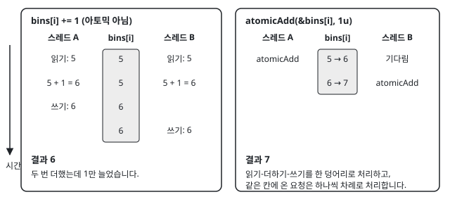
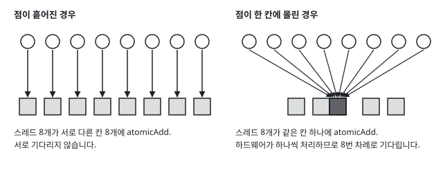
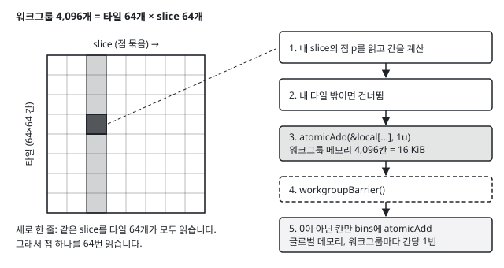

# 아토믹과 경합: 2D 히스토그램

지금까지 본 커널은 스레드마다 쓰는 위치가 달랐습니다. 이 장에서는 여러 스레드가 같은 위치에 동시에 더하는 경우를 다룹니다. 읽고 나면 값이 사라지는 이유, `atomicAdd`가 그것을 막는 방법, 같은 칸에 쓰기가 몰릴 때 느려지는 이유를 설명할 수 있습니다. 데모는 컴퓨트 벤치에서 "2D 빈닝 (밀도 히스토그램)"을 고르면 됩니다.

코드는 `src/demos/compute-bench/workloads/binning2d/`에 있습니다. `index.ts`에 WGSL 커널 두 개와 GPU 실행 코드가 있고, `bin.ts`에 CPU 구현, 입력 생성, 검증이 있습니다.

## 무엇을 세나

점이 수천만 개인 산점도는 점을 하나씩 그릴 수 없습니다. 대신 화면을 격자로 나누고 칸마다 점이 몇 개인지 센 다음, 그 개수를 색으로 칠합니다(히트맵). 이 워크로드는 그중 세는 단계만 잽니다.

- 입력은 `(x, y)` f32 쌍 n개입니다. 점 하나가 8바이트이고 값은 `[0, 1)` 범위입니다.
- 출력은 512×512칸의 `Uint32Array`(1 MiB)입니다. 이 칸 하나를 빈(bin)이라고 부릅니다.
- 점은 가우시안 군집 8개에서 뽑고, 5%만 전체에 고르게 뿌립니다(`clusteredPoints`). 실제 산점도처럼 점이 몇 군데에 몰려 있습니다. 시드가 같으면 같은 점이 나옵니다.

CPU 구현은 한 줄짜리 루프입니다.

`src/demos/compute-bench/workloads/binning2d/bin.ts` 10~16행:

```ts
export function binOf(v: number): number {
  return Math.min(Math.floor(v * GRID), GRID - 1);
}

export function binInto(points: Float32Array, counts: Uint32Array): void {
  for (let i = 0; i < points.length; i += 2) counts[binOf(points[i + 1]!) * GRID + binOf(points[i]!)]!++;
}
```

WGSL 커널도 같은 규칙 `min(floor(v * 512), 511)`을 씁니다. `v * 512`는 2의 거듭제곱을 곱하는 것이라 f32와 f64 모두 정확하게 계산됩니다. 그래서 CPU와 GPU가 비트 단위로 같은 칸을 고르고, 검증은 오차 허용 없이 262,144칸이 모두 같은지와 합계가 n인지를 봅니다(`compareCounts`).

## 같은 칸에 동시에 더하면

GPU에서 점 하나를 스레드 하나가 맡는다고 해 봅시다. 스레드는 칸을 계산하고 `bins[k] += 1`을 합니다. 이 한 줄은 실제로 세 단계입니다. 값을 읽고, 1을 더하고, 다시 씁니다. 두 스레드가 같은 칸에서 이 세 단계를 겹쳐 실행하면 더하기 하나가 사라집니다.



웹 서버에서도 같은 일이 생깁니다. 요청 핸들러 두 개가 DB에서 카운터를 읽고, 1을 더해 다시 저장하는 사이에 서로 끼어들면 카운트 하나를 잃습니다. 이런 상황을 경쟁 상태(race condition)라고 부릅니다. DB는 `UPDATE ... SET count = count + 1`처럼 읽기와 쓰기를 한 연산으로 묶어 해결합니다. GPU에서 그 역할을 하는 것이 아토믹(atomic) 연산입니다.

## `atomic<u32>`와 `atomicAdd`

`src/demos/compute-bench/workloads/binning2d/index.ts` 11~28행:

```ts
const SHARED = /* wgsl */ `
struct Params { count: u32, stride: u32 }
@group(0) @binding(0) var<storage, read> pts: array<vec2f>;
@group(0) @binding(1) var<storage, read_write> bins: array<atomic<u32>>;
@group(0) @binding(2) var<uniform> params: Params;

fn binOf(v: f32) -> u32 { return min(u32(floor(v * ${GRID}.0)), ${GRID - 1}u); }
`;

const GLOBAL_ATOMIC = /* wgsl */ `${SHARED}
@compute @workgroup_size(${GROUP})
fn main(@builtin(global_invocation_id) gid: vec3u) {
  for (var i = gid.x; i < params.count; i += params.stride) {
    let p = pts[i];
    atomicAdd(&bins[binOf(p.y) * ${GRID}u + binOf(p.x)], 1u);
  }
}
`;
```

`bins`의 원소 타입이 `atomic<u32>`입니다. WGSL의 아토믹에는 규칙이 몇 가지 있습니다.

- 원소 타입은 `u32`와 `i32`뿐입니다. f32 아토믹은 없습니다.
- `var<storage, read_write>`나 `var<workgroup>`에만 둘 수 있습니다.
- `bins[k]`처럼 일반 값으로 읽거나 쓸 수 없습니다. `atomicLoad`, `atomicStore`, `atomicAdd` 같은 내장 함수로만 다룹니다.
- `atomicAdd`는 더하기 전의 값을 돌려줍니다. 이 커널은 그 값을 쓰지 않습니다.

`atomicAdd`는 읽기, 더하기, 쓰기를 다른 스레드가 끼어들 수 없는 한 연산으로 처리합니다. 같은 칸에 동시에 온 요청은 하드웨어가 하나씩 차례로 처리합니다.

> **해보기**
> `index.ts` 25행을 아래 두 줄로 바꾸면 각 연산은 아토믹이지만 읽기와 쓰기 사이에 다른 스레드가 끼어들 수 있습니다.
> ```wgsl
>     let k = binOf(p.y) * ${GRID}u + binOf(p.x);
>     atomicStore(&bins[k], atomicLoad(&bins[k]) + 1u);
> ```
> 데모에서 `gpu-global-atomic`을 2^20 크기로 실행하고 check 열을 보세요. 실패하면 detail에 기준값과 다른 첫 빈이 나옵니다. 아토믹 연산 두 개를 이어 붙인다고 전체가 아토믹이 되지는 않습니다.

## 스레드 하나가 점 여러 개를 맡는 이유

위 커널의 `for` 루프는 `i`를 `params.stride`만큼 건너뛰며 점 여러 개를 처리합니다. 이 방식을 grid-stride 루프라고 부릅니다. 점 하나에 스레드 하나를 붙이지 않은 이유는 디스패치 한도 때문입니다.

`src/demos/compute-bench/workloads/binning2d/index.ts` 127~130행:

```ts
const globalAtomic = gpuImpl('gpu-global-atomic', 'WebGPU (전역 atomicAdd)', GLOBAL_ATOMIC, (n) => {
  const groups = Math.max(1, Math.min(Math.ceil(n / GROUP), MAX_GROUPS));
  return { groups, stride: groups * GROUP };
});
```

`dispatchWorkgroups`의 차원당 워크그룹 수 기본 한도(`maxComputeWorkgroupsPerDimension`)는 65,535입니다. n = 2^24이고 워크그룹이 256 스레드면 65,536개가 필요해 한도를 하나 넘습니다. 그래서 워크그룹 수를 `MAX_GROUPS`(8,192)로 묶고, 2^24에서는 스레드 하나가 점 8개를 맡습니다. 이 한도와 디스패치 크기 계산은 [03장](03-compute-reduction.md)에서 다뤘습니다.

## 경합: 같은 칸에 몰리면 줄을 섭니다

`atomicAdd`는 값을 잃지 않지만 비용이 있습니다. 서로 다른 칸에 가는 `atomicAdd`는 동시에 처리되고, 같은 칸에 가는 것은 차례를 기다립니다. 같은 자원을 여러 스레드가 동시에 원하는 상황을 경합(contention)이라고 부릅니다.



이 워크로드의 군집 데이터는 경합이 큽니다. `bin.test.ts`는 점 10만 개에서 가장 바쁜 칸의 개수가 균일 분포 평균의 50배를 넘는지 확인합니다. 그래서 이 데이터는 균일 분포보다 GPU에 불리합니다. 균일 분포와 직접 비교한 측정은 이 저장소에 없습니다.

## Privatization: 워크그룹 안에서 먼저 세기

경합을 줄이는 흔한 방법은 privatization입니다. 워크그룹마다 자기 히스토그램을 워크그룹 메모리에 두고 거기서 먼저 센 다음, 마지막에 글로벌 `bins`로 합칩니다. 경합은 워크그룹 안의 스레드 256개 사이로 줄고, 글로벌 아토믹 횟수는 점 수가 아니라 (워크그룹 수 × 0이 아닌 칸 수)가 됩니다. 워크그룹 메모리는 [04장](04-workgroup-memory.md)에서 다뤘습니다.

문제는 크기입니다. 512×512 히스토그램은 1 MiB인데 워크그룹 메모리의 기본 한도는 16 KiB, u32로 4,096칸입니다. 그래서 `gpu-privatized`는 격자를 64×64칸짜리 타일 64개로 나눕니다. 타일 하나가 딱 4,096칸입니다.



`src/demos/compute-bench/workloads/binning2d/index.ts` 32~55행:

```wgsl
var<workgroup> local: array<atomic<u32>, ${TILE * TILE}>;

@compute @workgroup_size(${GROUP})
fn main(@builtin(workgroup_id) wg: vec3u, @builtin(local_invocation_index) lid: u32) {
  let tile = wg.x % ${TILES}u;
  let slice = wg.x / ${TILES}u;
  let tx = (tile % ${GRID / TILE}u) * ${TILE}u;
  let ty = (tile / ${GRID / TILE}u) * ${TILE}u;
  for (var b = lid; b < ${TILE * TILE}u; b += ${GROUP}u) { atomicStore(&local[b], 0u); }
  workgroupBarrier();
  for (var i = slice * ${GROUP}u + lid; i < params.count; i += params.stride) {
    let p = pts[i];
    let bx = binOf(p.x);
    let by = binOf(p.y);
    if (bx - tx < ${TILE}u && by - ty < ${TILE}u) {
      atomicAdd(&local[(by - ty) * ${TILE}u + (bx - tx)], 1u);
    }
  }
  workgroupBarrier();
  for (var b = lid; b < ${TILE * TILE}u; b += ${GROUP}u) {
    let v = atomicLoad(&local[b]);
    if (v > 0u) { atomicAdd(&bins[(ty + b / ${TILE}u) * ${GRID}u + tx + b % ${TILE}u], v); }
  }
}
```

`TILE`은 64, `TILES`는 64, `GROUP`은 256입니다. 읽는 순서대로 보면 이렇습니다.

1. 워크그룹 번호 `wg.x`를 타일 번호와 slice 번호로 나눕니다. slice는 점 묶음입니다. 디스패치 크기가 `TILES * SLICES` = 4,096이라 (타일, slice) 조합마다 워크그룹이 하나씩 있습니다.
2. `local`을 0으로 채우고 배리어를 둡니다. `local_invocation_index`는 워크그룹 안의 스레드 번호를 0부터 255까지 한 줄로 센 값입니다.
3. slice의 점을 읽고, 내 타일 안에 있으면 `local`에 `atomicAdd`합니다. `bx - tx < 64u` 한 번으로 양쪽 범위를 검사합니다. `bx < tx`이면 u32 뺄셈이 2^32 가까운 큰 수로 넘어가 조건이 거짓이 됩니다.
4. 배리어로 모든 스레드가 세기를 마칠 때까지 기다립니다.
5. 0이 아닌 칸만 글로벌 `bins`에 더합니다. 다른 slice를 맡은 워크그룹 63개도 같은 타일의 칸에 더하므로 여기도 `atomicAdd`가 필요합니다.

대가는 읽기 횟수입니다. 워크그룹은 점이 어느 타일에 들어갈지 읽어 보기 전에는 모릅니다. 그래서 타일 64개가 같은 slice를 각자 읽고, 점 하나를 64번 읽게 됩니다. n = 2^24이면 128 MiB × 64 = 8 GiB입니다. 이 구현에서는 경합을 줄여 얻는 시간보다 이 중복 읽기 비용이 큽니다. 점을 먼저 타일별로 나눠 두는 단계를 추가하면 중복 읽기를 없앨 수 있지만, 이 저장소에서는 구현하지 않았습니다.

> **해보기**
> `index.ts` 6행의 `TILE`을 32로 바꿔 보세요. `local`은 4 KiB로 줄지만 `TILES`가 256이 되어 점 하나를 256번 읽습니다. 데모 표의 `gpu-privatized` kernel 열이 어떻게 바뀌는지 보세요. 반대로 128로 바꾸면 `local`이 64 KiB가 되어 워크그룹 메모리 한도를 넘고 파이프라인 생성이 실패합니다.

## clearBuffer: 매번 0에서 시작하기

히스토그램은 더하기만 하므로 실행할 때마다 `bins`가 0이어야 합니다. 같은 버퍼를 여러 번 재사용하기 때문에, 이전 실행의 값이 남아 있습니다.

`src/demos/compute-bench/workloads/binning2d/index.ts` 104~112행:

```ts
        encode(encoder, ts) {
          encoder.clearBuffer(bins);
          const pass = encoder.beginComputePass({ timestampWrites: ts?.only });
          pass.setPipeline(pipeline);
          pass.setBindGroup(0, bindGroup);
          pass.dispatchWorkgroups(groups);
          pass.end();
          encoder.copyBufferToBuffer(bins, 0, readBuf, 0, BINS * 4);
        },
```

`clearBuffer`는 커맨드 인코더에 "이 버퍼를 0으로 채워라"를 기록합니다. 컴퓨트 패스 밖의 명령이므로 timestamp-query로 재는 kernel 시간에는 들어가지 않고 e2e에는 들어갑니다. `bins`를 만들 때 `GPUBufferUsage.COPY_DST`를 켠 이유가 이 호출입니다(87행). 이 줄을 빼면 측정 전 워밍업 실행의 결과가 남아 첫 측정부터 합계가 n의 두 배가 되고 검증이 실패합니다.

## 측정값

헤드리스 Chromium, Apple M1, 1회 측정, 참고용입니다. n = 2^24(점 약 1,677만 개) 기준입니다.

| 구현 | e2e (ms) | kernel (ms) |
|---|---|---|
| cpu-loop | 49 | 없음 |
| gpu-global-atomic | 39 | 5 |
| gpu-privatized | 91 | 59 |

- `gpu-global-atomic`의 kernel은 5 ms인데 e2e는 39 ms입니다. 나머지 대부분은 점 128 MiB를 GPU로 올리는 시간입니다. 이 크기의 한계는 연산이 아니라 업로드입니다.
- 교차점은 약 2^21입니다. 그보다 작으면 CPU가 빠릅니다. 점 하나에 하는 일이 정수 덧셈 한 번이라 GPU가 업로드 비용을 갚을 만큼 일이 없습니다.
- `gpu-privatized`의 kernel 59 ms는 점을 64번 읽는 비용입니다. 경합은 줄었지만 이 구현에서는 전역 아토믹보다 느립니다.

[04장의 행렬 곱](04-workgroup-memory.md)은 옮긴 값 하나에 연산을 수천 번 해서 일찍 교차했습니다. 빈닝은 값 하나에 연산 한 번이라, 교차점이 늦고 GPU가 이겨도 차이가 작습니다.

> **해보기**
> 데모에서 2D 빈닝의 모든 크기와 구현을 켜고 실행해 보세요. 표에서 `gpu-global-atomic`의 e2e에서 kernel을 뺀 값을 크기별로 계산해 보세요. 큰 n에서 이 차이가 n에 거의 비례해 늘어난다면, 점 수에 비례하는 업로드가 차이의 대부분이라는 뜻입니다. 작은 n에서는 제출과 읽기의 고정 비용이 차이를 차지합니다.

## 데이터가 이미 GPU에 있다면

kernel 열은 점이 이미 GPU에 있을 때의 시간입니다. 예를 들어 시뮬레이션이 점 위치를 GPU 버퍼에 만들고 바로 히트맵을 그린다면 업로드가 없습니다. `bins`를 읽어 오지 않고 렌더 패스의 프래그먼트 셰이더가 `var<storage, read>`로 바인딩해 색을 칠하면 됩니다. 이 데모의 워크로드에는 그리기 단계가 없어서 구현하지 않았습니다. 계산 결과를 GPU 안에서 바로 그리는 방법은 [07장](07-compute-to-render.md)에서 N-body로 봅니다.

## 정리

- 여러 스레드가 같은 위치에 읽기, 더하기, 쓰기를 하면 경쟁 상태로 값이 사라집니다.
- `atomic<u32>`와 `atomicAdd`는 이 세 단계를 한 연산으로 묶습니다. 아토믹 연산 두 개를 이어 붙이면 다시 경쟁이 생깁니다.
- 같은 칸에 아토믹이 몰리면 차례를 기다립니다(경합). privatization은 워크그룹 메모리에 먼저 세서 경합을 줄이지만, 이 구현에서는 중복 읽기 비용이 더 컸습니다.
- 점 하나에 연산이 한 번뿐인 작업은 업로드가 시간을 정합니다. 데이터가 이미 GPU에 있을 때 GPU의 이득이 큽니다.

## 다음 장

아토믹은 개수를 세기에는 좋지만 순서를 정해 주지는 않습니다. [06장: 여러 패스로 정렬하기](06-multi-pass-sort.md)에서는 순서가 중요한 정렬을 아토믹 없이 히스토그램, 스캔, 스캐터로 풉니다.
