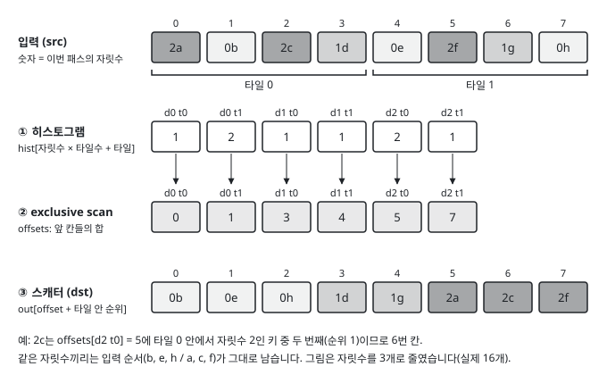
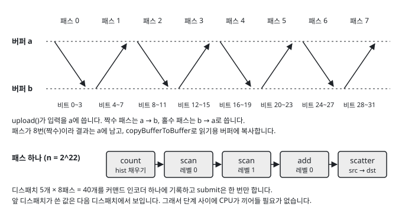

# 여러 패스로 정렬하기: 기수 정렬

이 장은 GPU에서 u32 키를 정렬하는 기수 정렬(radix sort)을 따라갑니다. 읽고 나면 쓰기 위치가 데이터에 따라 달라지는 작업을 GPU가 어떻게 처리하는지, 디스패치 수십 개를 한 번에 제출하는 이유, 버퍼 두 개를 번갈아 쓰는 이유를 설명할 수 있습니다. 데모는 컴퓨트 벤치에서 "기수 정렬 (u32 키)"을 고르면 됩니다.

[03장](03-compute-reduction.md)의 트리 리덕션과 [05장](05-atomics.md)의 아토믹을 안다고 가정합니다.

코드는 `src/demos/compute-bench/workloads/radix-sort/`에 있습니다.

| 파일 | 내용 |
|---|---|
| `cpu-radix.ts` | JS 기수 정렬. 8비트 자릿수 4패스 (`cpu-radix`) |
| `gpu-radix.ts` | WebGPU 기수 정렬. 4비트 자릿수 8패스 (`gpu-radix`) |
| `tiling.ts` | 타일 크기, 스캔 블록 크기, 스캔 단계 수를 계산하는 순수 함수 |
| `index.ts` | 워크로드 정의, `Uint32Array.prototype.sort` 기준선(`cpu-typed-sort`), 검증 |

## 정렬이 어려운 이유

지금까지 본 커널은 스레드가 어디에 쓸지를 인덱스만 보고 정했습니다. 행렬 곱의 스레드 `(x, y)`는 `C[y][x]`에 씁니다. 정렬은 다릅니다. 키가 어디로 갈지는 키 값과 다른 모든 키를 봐야 정해집니다. 이런 쓰기를 스캐터(scatter)라고 부릅니다.

비교 정렬(퀵 정렬, 병합 정렬)은 단계마다 비교 결과에 따라 스레드가 하는 일이 갈립니다. 기수 정렬은 비교를 하지 않습니다. 각 키가 갈 위치를 먼저 개수 세기와 누적합으로 계산하고, 그다음 모든 키를 한 번에 옮깁니다. 세 단계 모두 키마다 같은 일을 하므로 스레드 수천 개에 나눠 맡길 수 있습니다.

## 먼저 JS로: LSD 기수 정렬

LSD(least significant digit first) 기수 정렬은 가장 낮은 자릿수부터 자릿수 하나씩 키를 재배치합니다. 32비트 키를 8비트씩 자르면 4패스입니다. 한 패스는 세 단계입니다.

`src/demos/compute-bench/workloads/radix-sort/cpu-radix.ts` 13~29행:

```ts
  for (let pass = 0; pass < PASSES; pass++) {
    const shift = pass * BITS;
    count.fill(0);
    for (let i = 0; i < n; i++) count[(src[i]! >>> shift) & 0xff]!++;
    let sum = 0;
    for (let d = 0; d < BUCKETS; d++) {
      const c = count[d]!;
      count[d] = sum;
      sum += c;
    }
    for (let i = 0; i < n; i++) {
      const key = src[i]!;
      dst[count[(key >>> shift) & 0xff]!++] = key;
    }
    src = dst;
    dst = src === a ? b : a;
  }
```

1. **히스토그램.** 이번 자릿수 값(0~255)마다 키가 몇 개인지 셉니다. 05장의 히스토그램과 같은 일입니다.
2. **exclusive scan.** 개수를 앞에서부터 누적해, 자릿수 `d`인 키가 들어갈 첫 위치를 구합니다. 개수 `[3, 1, 2]`는 위치 `[0, 3, 4]`가 됩니다. 자기 자신을 빼고 앞 칸까지만 더하므로 exclusive scan(배타적 누적합)이라고 부릅니다.
3. **스캐터.** 키를 입력 순서대로 읽어 자기 자릿수의 다음 빈 위치에 씁니다.

마지막 두 줄은 `src`와 `dst`를 맞바꿉니다. 이 장 뒤쪽의 핑퐁 버퍼가 같은 방식입니다.

## 안정성: 같은 자릿수는 입력 순서대로

한 패스에서 자릿수가 같은 키끼리는 입력 순서를 그대로 지켜야 합니다. 이 성질을 안정성(stability)이라고 부릅니다.

LSD 정렬은 안정성에 기대어 동작합니다. 두 번째 패스는 두 번째 자릿수만 보고 키를 재배치합니다. 두 번째 자릿수가 같은 키끼리는 첫 번째 패스가 만든 순서, 즉 첫 번째 자릿수 순서를 유지해야 합니다. 그래야 두 패스 뒤에 하위 16비트 기준으로 정렬된 상태가 됩니다. 어느 패스든 순서를 뒤섞으면 앞 패스의 결과가 사라집니다.

이 버그는 첫 패스만 보면 드러나지 않습니다. 첫 패스의 출력은 그 자릿수 기준으로 잘 정렬되어 있기 때문입니다. 그래서 `index.ts`의 검증은 정렬된 복사본과 모든 원소를 비교하고, `verify.test.ts`에는 패스마다 같은 자릿수의 순서를 뒤집는 불안정 정렬의 결과를 검증이 거부하는지 보는 테스트가 있습니다.

> **해보기**
> `cpu-radix.ts` 23행의 스캐터 루프를 `for (let i = n - 1; i >= 0; i--)`로 바꿔 보세요. 패스마다 자릿수 기준으로는 여전히 정렬되지만, 같은 자릿수 안의 순서가 뒤집힙니다. `npm test`를 실행하면 `cpu-radix.test.ts`의 "matches the native sort" 테스트가 실패합니다.

## GPU에서 한 패스

GPU 구현은 4비트 자릿수(`RADIX` = 16)로 8패스를 돕니다. 한 패스의 세 단계는 JS와 같지만, 키 수백만 개를 스레드 하나가 순서대로 셀 수는 없으니 키를 타일로 나눕니다. 타일은 키 256개(`TILE`)이고 워크그룹 하나가 맡습니다.



### 1. 타일별 히스토그램

count 커널은 타일마다 자릿수 16개의 개수를 세어 `hist[digit * tiles + tile]`에 씁니다. 표를 자릿수 우선으로 펼친 것이 핵심입니다. 이 순서로 놓고 표 전체를 exclusive scan하면, 칸 `(d, t)`의 값은 "자릿수가 `d`보다 작은 모든 키의 수 + 자릿수가 `d`이고 앞 타일에 있는 키의 수"가 됩니다. 이 값이 바로 타일 `t`의 자릿수 `d` 키들이 들어갈 첫 위치입니다.

`src/demos/compute-bench/workloads/radix-sort/gpu-radix.ts` 36~45행:

```wgsl
@compute @workgroup_size(${THREADS})
fn main(@builtin(workgroup_id) wg: vec3u, @builtin(local_invocation_index) lid: u32) {
  var mine: array<u32, ${PER_THREAD}>;
  load_counts(wg.x * ${TILE}u + lid * ${PER_THREAD}u, lid, &mine);
  if (lid < ${RADIX}u) {
    var total = 0u;
    for (var t = 0u; t < ${THREADS}u; t++) { total += cnt[lid * ${THREADS}u + t]; }
    hist[lid * p.tiles + wg.x] = total;
  }
}
```

`THREADS`는 64, `PER_THREAD`는 4입니다. 스레드 하나가 연속된 키 4개를 맡습니다. `load_counts`는 아래 스캐터 절에서 봅니다. 그 뒤 스레드 16개가 자릿수 하나씩 맡아, 스레드 64개의 개수를 더해 `hist`에 씁니다.

### 2. 표 전체의 exclusive scan

스캔 커널(`SCAN_WGSL`)은 워크그룹 하나가 512칸(`SCAN_BLOCK`)을 스레드 256개로 스캔합니다. 방식은 Blelloch 스캔입니다. 앞 절반은 03장의 트리 리덕션과 같은 모양으로 짝지어 더해 올라가고(up-sweep), 맨 위 합계를 따로 저장한 뒤, 같은 트리를 내려오며 값을 바꿔 넣어 exclusive scan을 만듭니다(down-sweep).

표가 512칸보다 크면 블록마다 따로 스캔하고, 블록 합계를 모아 다시 스캔한 뒤, 그 결과를 각 블록에 더합니다(`add` 진입점). 필요한 단계 수는 `tiling.ts`가 계산합니다.

`src/demos/compute-bench/workloads/radix-sort/tiling.ts` 16~21행:

```ts
/** Entry counts of the scan hierarchy. levels[0] is the (digit, tile) table; the last level fits one block. */
export function scanLevels(entries: number): number[] {
  const levels = [entries];
  while (levels[levels.length - 1]! > SCAN_BLOCK) levels.push(Math.ceil(levels[levels.length - 1]! / SCAN_BLOCK));
  return levels;
}
```

키 2^22개면 타일 16,384개, 표 262,144칸입니다. `scanLevels`는 `[262144, 512]`를 돌려주고, 스캔 디스패치 2개와 add 디스패치 1개가 필요합니다. 이 계산은 GPU 없이 `tiling.test.ts`에서 테스트합니다.

### 3. 스캐터와 타일 안 순위

키의 최종 위치는 `offsets[d][t] + 타일 안 순위`입니다. 타일 안 순위는 "같은 타일에서 자릿수가 같고 나보다 앞에 있는 키의 수"입니다.

05장의 `atomicAdd`로 순위를 구하고 싶을 수 있습니다. `atomicAdd(&counter[d], 1u)`는 더하기 전 값을 돌려주므로 그 값을 순위로 쓰면 됩니다. 하지만 어느 스레드가 먼저 아토믹에 도착할지는 정해져 있지 않습니다. 같은 자릿수 키의 순서가 실행마다 달라지고 안정성이 깨집니다. 아토믹은 개수를 셀 때는 맞지만 순서를 정해 주지는 않습니다.

이 구현은 아토믹 없이 순위를 구합니다. 먼저 스레드마다 자기 키 4개의 자릿수 개수를 워크그룹 메모리 표 `cnt[digit][thread]`에 적습니다.

`src/demos/compute-bench/workloads/radix-sort/gpu-radix.ts` 16~29행:

```wgsl
fn load_counts(base: u32, lid: u32, mine: ptr<function, array<u32, ${PER_THREAD}>>) {
  var local: array<u32, ${RADIX}>;
  for (var j = 0u; j < ${PER_THREAD}u; j++) {
    let i = base + j;
    var d = ${RADIX}u;
    if (i < p.n) {
      d = (keys[i] >> p.shift) & ${RADIX - 1}u;
      local[d] += 1u;
    }
    (*mine)[j] = d;
  }
  for (var d = 0u; d < ${RADIX}u; d++) { cnt[d * ${THREADS}u + lid] = local[d]; }
  workgroupBarrier();
}
```

범위 밖 키(마지막 타일의 남는 칸)는 자릿수를 `RADIX`(16)로 표시해 개수에도 순위에도 넣지 않습니다. 그다음 스캐터 커널이 이 표를 자릿수마다 스레드 순서로 누적합니다.

`src/demos/compute-bench/workloads/radix-sort/gpu-radix.ts` 53~76행:

```wgsl
@compute @workgroup_size(${THREADS})
fn main(@builtin(workgroup_id) wg: vec3u, @builtin(local_invocation_index) lid: u32) {
  let base = wg.x * ${TILE}u + lid * ${PER_THREAD}u;
  var mine: array<u32, ${PER_THREAD}>;
  load_counts(base, lid, &mine);
  if (lid < ${RADIX}u) {
    var run = 0u;
    for (var t = 0u; t < ${THREADS}u; t++) {
      let c = cnt[lid * ${THREADS}u + t];
      cnt[lid * ${THREADS}u + t] = run;
      run += c;
    }
  }
  workgroupBarrier();
  var seen: array<u32, ${RADIX}>;
  for (var j = 0u; j < ${PER_THREAD}u; j++) {
    let d = mine[j];
    if (d < ${RADIX}u) {
      let rank = cnt[d * ${THREADS}u + lid] + seen[d];
      seen[d] += 1u;
      out[offsets[d * p.tiles + wg.x] + rank] = keys[base + j];
    }
  }
}
```

배리어 뒤 `cnt[d][t]`는 "스레드 `t`보다 앞 스레드들이 가진 자릿수 `d` 키의 수"입니다. 스레드는 자기 키를 순서대로 보며 `seen[d]`로 자기 안에서 앞선 키를 셉니다. 둘을 더한 `rank`는 입력 순서만으로 정해지므로 실행할 때마다 같고, 안정성이 지켜집니다.

자릿수 16개의 누적합을 스레드 16개가 각자 64칸씩 순서대로 돕니다. 나머지 48개 스레드는 그동안 기다립니다. 병렬 스캔보다 느리지만 읽기 쉬운 쪽을 택한 구현입니다.

## 워크그룹 사이의 순서는 디스패치로 정합니다

스캔은 모든 타일의 히스토그램이 끝난 뒤에 시작해야 합니다. 그런데 [03장](03-compute-reduction.md)에서 본 것처럼 `workgroupBarrier()`는 워크그룹 안에서만 동작하고, 한 디스패치 안의 워크그룹끼리는 기다릴 방법이 없습니다. 그래서 단계마다 디스패치를 나눕니다.

`src/demos/compute-bench/workloads/radix-sort/gpu-radix.ts` 194~199행:

```ts
        radixPasses.forEach((rp, i) => {
          dispatch(count, rp.count, tiles, i === 0 ? ts?.first : undefined);
          for (const step of scanSteps) dispatch(scan, step.scan, step.groups);
          for (let k = scanSteps.length - 2; k >= 0; k--) dispatch(add, scanSteps[k]!.add, scanSteps[k]!.groups);
          dispatch(scatter, rp.scatter, tiles, i === PASSES - 1 ? ts?.last : undefined);
        });
```

패스 하나의 디스패치 수는 count 1 + scan (단계 수) + add (단계 수 - 1) + scatter 1입니다. 2^22개면 5개이고, 8패스면 40개입니다. 이것을 모두 커맨드 인코더 하나에 기록하고 `queue.submit`은 한 번만 합니다.

WebGPU는 큐에 넣은 명령이 순서대로 실행된 것처럼 보이도록 보장합니다. 앞 디스패치가 storage 버퍼에 쓴 값은 다음 디스패치가 읽을 때 보입니다. Vulkan 같은 저수준 API에서는 개발자가 직접 넣어야 하는 메모리 배리어를 WebGPU 구현이 대신 넣습니다. 그래서 단계 사이에 CPU로 돌아와 `await`할 필요가 없습니다. JS로 치면 `await`를 40번 하는 대신 작업 목록 하나를 통째로 넘기는 것과 같습니다.

이 코드는 디스패치마다 컴퓨트 패스를 하나씩 엽니다(187~193행의 `dispatch` 함수). 그래서 첫 패스에 시작 타임스탬프(`ts.first`), 마지막 패스에 끝 타임스탬프(`ts.last`)를 붙여 40개 전체의 kernel 시간을 잴 수 있습니다.

## 핑퐁 버퍼

스캐터는 읽는 버퍼와 쓰는 버퍼가 달라야 합니다. 같은 버퍼면 다른 워크그룹이 아직 읽지 않은 키를 덮어씁니다. 그래서 버퍼 `a`, `b` 두 개를 두고 패스마다 역할을 바꿉니다. 이것을 핑퐁(ping-pong) 버퍼라고 부릅니다.



`src/demos/compute-bench/workloads/radix-sort/gpu-radix.ts` 175~180행:

```ts
    const radixPasses = Array.from({ length: PASSES }, (_, i) => {
      const src = i % 2 === 0 ? a : b;
      const dst = i % 2 === 0 ? b : a;
      const params = uniform(n, i * DIGIT_BITS, tiles);
      return { count: bind(count, [src, hist, params]), scatter: bind(scatter, [src, hist, params, dst]) };
    });
```

패스 8개의 바인드 그룹을 `prepare`에서 미리 만들어 둡니다. 패스 `i`는 `shift`가 `i * 4`인 유니폼 버퍼를 갖습니다. 패스가 8번(짝수)이라 결과는 `a`에 남고, 200행에서 `copyBufferToBuffer`로 읽기용 버퍼에 복사합니다. 다음 실행의 `upload()`가 `a`를 새 입력으로 덮어쓰므로 같은 버퍼를 여러 번 재사용해도 결과가 섞이지 않습니다.

## 측정값

헤드리스 Chromium, Apple M1, 1회 측정, 참고용입니다. 키 2^22개(약 419만 개) 기준입니다.

| 구현 | e2e (ms) | kernel (ms) |
|---|---|---|
| cpu-typed-sort | 103 | 없음 |
| cpu-radix | 40 | 없음 |
| gpu-radix | 34 | 25 |

- 교차점은 2^19와 2^20 사이입니다. 작은 n에서는 GPU가 디스패치 수십 개의 고정 비용 아래로 내려가지 못합니다.
- `cpu-typed-sort`와 비교하면 GPU가 약 3배 빠릅니다. JS 기수 정렬과 비교하면 약 1.2배입니다. "GPU가 몇 배 빠르다"는 결론은 어떤 CPU 구현과 비교하느냐에 달려 있습니다.
- 두 CPU 구현은 입력을 바꾸지 않으려고 매번 복사본이나 스크래치 버퍼를 새로 만들고, 그 비용도 시간에 들어갑니다.
- e2e와 kernel의 차이 9 ms는 키 16 MiB를 올리고 16 MiB를 읽어 오는 시간과 제출 비용입니다.

kernel 25 ms가 메모리 대역폭 한계에 얼마나 가까운지 어림해 보겠습니다. 패스마다 키를 적어도 count에서 한 번, scatter에서 한 번 읽고 한 번 씁니다. 16 MiB × 3 × 8패스 = 384 MiB이고, 25 ms에 옮기면 약 15 GB/s입니다. M1의 메모리는 LPDDR4X-4266, 128비트 버스라서 4,266 MT/s × 16바이트 ≈ 68 GB/s가 이론 대역폭입니다. kernel은 그보다 한참 아래에서 돌고 있습니다.

무엇이 시간을 정하는지는 프로파일러로 확인하지 않았습니다. 코드에서 추정한 후보는 셋입니다. 첫째, count와 scatter에서 스레드 16개만 64단계를 순서대로 도는 구간입니다. 둘째, 워크그룹이 64 스레드로 작습니다. 셋째, 디스패치가 40개라 디스패치마다 드는 고정 비용이 쌓입니다. 자릿수를 8비트로 늘려 패스를 4번으로 줄이거나, 타일 안 누적합을 병렬 스캔으로 바꾸면 이 가설을 시험할 수 있습니다.

> **해보기**
> 데모에서 기수 정렬의 모든 크기와 구현을 켜고 실행한 뒤 교차점 문구를 보세요. 그다음 `cpu-radix`의 체크를 끄고 다시 실행해 보세요. 교차점 계산(`src/core/oneshot.ts`의 `crossoverN`)은 크기마다 가장 빠른 CPU 구현과 가장 빠른 GPU 구현을 비교합니다. 그래서 빠른 CPU 구현을 빼면 교차점은 같은 크기에 머물거나 더 작은 크기로 내려갑니다. 얼마나 내려가는지가 기준선 선택의 영향입니다.

> **해보기**
> `gpu-radix.ts` 4행의 `THREADS`를 128로 바꾸면 스레드당 키가 2개가 되고, 자릿수별 누적합 루프는 64단계에서 128단계로 길어집니다. kernel 열이 줄어드는지 늘어나는지 보면 위 첫째 후보가 얼마나 중요한지 짐작할 수 있습니다. `cnt`는 16 × 128 × 4바이트 = 8 KiB라 워크그룹 메모리 한도 안에 있습니다.

## 정리

- 정렬처럼 쓰기 위치가 데이터에 따라 정해지는 작업은 위치를 먼저 계산(히스토그램, exclusive scan)하고 한 번에 옮기는(스캐터) 방식으로 GPU에 맞출 수 있습니다.
- LSD 기수 정렬은 패스마다 안정적이어야 맞습니다. 아토믹으로 구한 순위는 도착 순서에 따라 바뀌므로 쓰지 않고, 스레드 순서 누적합으로 순위를 정합니다.
- 워크그룹 사이의 순서는 디스패치를 나눠 만듭니다. 디스패치 40개를 인코더 하나에 기록해 한 번에 제출하면 CPU가 중간에 기다릴 필요가 없습니다.
- 핑퐁 버퍼는 읽는 버퍼와 쓰는 버퍼를 패스마다 바꿔 덮어쓰기를 막습니다.

## 다음 장

여기까지는 결과를 CPU로 읽어 와서 확인했습니다. [07장: 계산 결과를 바로 그리기](07-compute-to-render.md)에서는 N-body 시뮬레이션으로 컴퓨트 결과를 읽어 오지 않고 같은 버퍼로 바로 그립니다.
